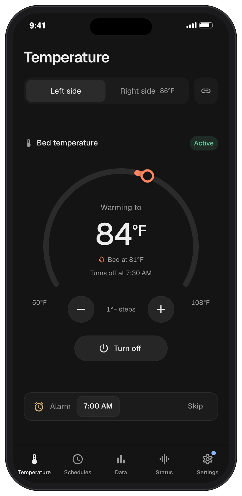

# Installing Free Pod

This guide takes a Pod from sealed to a working Free Pod install with the internet blocked.
It covers the Pod 3, Pod 4 and Pod 5.

**Only a Pod 5 was tested.** Free Pod was installed and run on one Pod 5. The Pod 3 and Pod 4
steps and photos come from the original project
([throwaway31265/free-sleep](https://github.com/throwaway31265/free-sleep)) and were not run with
Free Pod. [docs/POD_MODELS.md](docs/POD_MODELS.md) lists what differs on a Pod 3 or 4.

Plan for about two hours. The commands are for a Mac or Linux computer; Windows is not covered.

If you get stuck, open an issue at https://github.com/jalen-cheng/free-sleep/issues and include
the output of `fs-debug` if the install got that far.

## Which Pods

| Pod | Status |
|---|---|
| Pod 1, Pod 2 | Not compatible |
| Pod 3 with an SD card | Different way in; see below. Not tested with Free Pod |
| Pod 3 without an SD card (FCC ID 2AYXT61100001) | Steps below. Not tested with Free Pod |
| Pod 4 | Steps below. Not tested with Free Pod |
| Pod 5 | Steps below. Tested on one Pod |

The FCC ID is on the back of the Pod, where the water tubes plug in.

**Pod 3 with an SD card.** Root access is gained through the SD card, not the serial cable. The
original project recommends doing it from Linux and gives two routes; neither was tried with Free Pod:

- Follow https://blopker.com/writing/04-zerosleep-1/ to get root, then start this guide at
  [step 9](#9-disable-eight-sleeps-updates) and skip [step 10](#10-wi-fi). Run step 9 as soon as
  you are in over SSH; until then the Pod can update its firmware and lock you out.
- Or try [this script](https://github.com/Pixel-Meister/freesleep_script/blob/main/modify_eight_sleep.sh)
  that modifies the SD card.

**Newer Pod 5 units may not be installable.** Upstream
[issue #66](https://github.com/throwaway31265/free-sleep/issues/66) reports a Pod 5 whose boot
loader never shows the `Hit any key to stop autoboot` prompt. Without that prompt this guide
cannot get root access. [Step 4](#4-power-on-and-stop-the-boot) says what to look for. If yours is
like that, stop there: nothing has been changed and the Pod still works with the Eight Sleep app.

## Before you start

**Pod 5 only:** set the Pod up in the Eight Sleep app first. This also saves your Wi-Fi network on
the Pod, which step 10 relies on.

Tools:

- [TC2070-IDC tag-connect cable](https://www.tag-connect.com/product/tc2070-idc) (about $50). You
  can solder three wires to the header instead.
- [FTDI FT232RL USB serial adapter](https://www.amazon.com/gp/product/B07TXVRQ7V/) (about $13)
- [Dupont wires](https://www.amazon.com/Elegoo-EL-CP-004-Multicolored-Breadboard-arduino/dp/B01EV70C78) (about $7)
- A Torx screwdriver set and a towel to work on

On your computer:

1. Install a serial terminal. On a Mac:
   ```
   brew install minicom
   ```
   On Linux, install `minicom` with your package manager.
2. Have an SSH public key ready. Print it with:
   ```
   cat ~/.ssh/id_ed25519.pub
   ```
   If that file does not exist, create a key first, then print it:
   ```
   ssh-keygen -t ed25519
   ```
3. Choose two new passwords, one for the Pod's `root` user and one for its `rewt` user.
4. Pod 3 and Pod 4: have your Wi-Fi name and password ready. Use your main network, not a guest
   network. Do not try to cut the Pod off from the internet at the router; step 16 does that on the Pod.

## 1. Open the hub

1. Unplug the Pod from the wall. A Pod 5 can be turned off in the Eight Sleep app first.
2. Put the hub on a towel and keep it upright. It has water in it. The cover does not need to be
   connected for the serial steps.
3. Take the hub apart:
   - Pod 3: [photos](docs/pod_3_teardown)
   - Pod 4: [photos](docs/pod_4_teardown) and [written steps](docs/pod_4_teardown/instructions.md)
   - Pod 5: there are no Pod 5 photos. Follow the
     [Pod 4 written steps](docs/pod_4_teardown/instructions.md); the test Pod 5 came apart the
     same way. Remove the four Torx screws under the rubber feet, lift the hub off its base by
     both side panels, then slide each side panel and the front grille down about half an inch and off.
4. Nothing needs more force than a firm slide. If a panel does not move, look for a screw you missed.

## 2. Wire the adapter and connect it to the board

Only three wires are used: ground, transmit and receive.

1. Connect the tag-connect cable to the FTDI adapter with Dupont wires, following the photos in
   [docs/jtag](docs/jtag).
2. Find the header on the board. It is a small grid of bare gold pads with alignment holes beside it.
   - Pod 3: [photo](docs/pod_3_teardown/7_pod_3_board_connection.jpeg)
   - Pod 4: [photo](docs/pod_4_teardown/2_circuit_board.png)
   - Pod 5: the board has two such grids on its right edge. Use the lower one, labelled **J7**,
     level with the end of the long socket the blue module plugs into. Leave **J10**, just above
     it, alone. The [Pod 4 photo](docs/pod_4_teardown/2_circuit_board.png) shows what the pads look like.
3. Press the tag-connect cable onto the pads. The alignment pins let it fit one way only. It does
   not latch, so hold or clip it in place for the whole session.
4. Plug the FTDI adapter into your computer. Leave the Pod unplugged.

## 3. Start the serial terminal

1. Find the adapter's device name:
   ```
   ls /dev/tty*
   ```
   On a Mac it looks like `/dev/tty.usbserial-B0010NHK`.
2. Start minicom at 921600 baud with the name you saw:
   ```
   minicom -b 921600 -o -D /dev/tty.usbserial-B0010NHK
   ```

You should see this:


## 4. Power on and stop the boot

1. Plug the Pod's power in and watch the terminal.
2. When `Hit any key to stop autoboot` appears, press Ctrl+C at once. You have a couple of seconds.


If it worked, you are at the boot prompt:


If it did not work:

| What you see | What to do |
|---|---|
| You missed the prompt | Unplug the Pod, wait ten seconds, plug it in and try again |
| Nothing is printed at all | Transmit and receive are probably swapped. Unplug the Pod, swap those two wires, try again. If still nothing, run `ls /dev/tty*` again; the adapter may have another name |
| Garbage characters | The speed is wrong. It must be 921600 |
| The log scrolls to `eight-pod login:` and there never was a `Hit any key` line | This is the newer Pod 5 boot loader described above. Try once more, holding Ctrl+C from before the power goes in. If it still does not stop, **stop here** and close the Pod. Nothing has been changed |

**The serial line drops characters now and then.** From here until SSH works, type slowly and read
each line before pressing Enter. A command that fails with `command not found` and is missing its
first letter just needs typing again.

## 5. Boot into a root shell

1. Check the boot slot:
   ```
   printenv current_slot
   ```
   It must print `current_slot=a`. If it prints anything else, stop. Reset the firmware (see
   [Going back to Eight Sleep](#going-back-to-eight-sleep)) and start again. If it is still not
   `a`, open an issue.
2. Set the boot arguments:
   ```
   setenv bootargs "root=PARTLABEL=rootfs_a rootwait init=/bin/bash"
   ```
3. Boot:
   ```
   run bootcmd
   ```

Lines about `GPT` and `GNU Parted` during the boot were normal on the test Pod 5. Do not try to
correct the disk.

## 6. Mount the file system

You now have a bare shell. Run these one at a time:

```
mount -t proc proc /proc
```
```
mount -t sysfs sysfs /sys
```
```
mount -t devtmpfs devtmpfs /dev
```
```
mount -t tmpfs tmpfs /run
```
```
mount -o remount,rw /
```

- `mount: /dev: devtmpfs already mounted` is harmless.
- The last command should print a line containing `EXT4-fs` and `re-mounted`. From here the
  system's files are writable, so type only what this guide says.

## 7. Set the passwords and reboot

1. Set the `root` password:
   ```
   passwd root
   ```
2. Set the `rewt` password:
   ```
   passwd rewt
   ```
3. Save the changes:
   ```
   sync
   ```
4. Reboot. **Do not interrupt the boot this time.**
   ```
   reboot -f
   ```

- Nothing is shown while you type a password, not even dots.
- If the two entries do not match, run the command again.
- `account root has password changed in future` is harmless. The clock is not set yet.
- Each `passwd` must end by saying the password was updated before you run `sync`.

## 8. Log in

Wait for the login prompt and log in as `root` with the password you just set. On a Pod 4 or 5 the
screen looks a little different from this Pod 3 one.


## 9. Disable Eight Sleep's updates

Do this straight after logging in, without delay. Until it is done the Pod can update itself. On a
Pod 5 it may already know your Wi-Fi from the Eight Sleep app, and step 7 reboots it with Eight
Sleep's services running, so it can be online before you get here. Some lines will say a service
was not loaded or does not exist. That is expected.

1. Stop and disable the services:
   ```
   systemctl disable --now swupdate-progress swupdate defibrillator eight-kernel telegraf vector frankenfirmware dac swupdate.socket
   ```
2. Mask them so they stay off after a restart:
   ```
   systemctl mask swupdate-progress swupdate defibrillator eight-kernel telegraf vector frankenfirmware dac swupdate.socket
   ```

## 10. Wi-Fi

First check whether the Pod is already on your network:

```
nmcli -g ip4.address device show wlan0
```

**If it prints an address, such as `192.168.1.50/24`, skip the rest of this step.** This is the
normal case on a Pod 5: setting it up in the Eight Sleep app saved your network on the Pod (on the
test Pod the saved profile was called `customer-wifi`).

> **Pod 5: do not run the commands below if you already have an address.** The `sed` line gives
> every saved Wi-Fi profile the same ID. On the test Pod 5, which then had more than one profile,
> Wi-Fi did not come back after a reboot. The recovery is at the end of this step.

Only if no address was printed, add your network:

1. Replace `WIFI_NAME` (it appears twice) and `PASSWORD` with your own:
   ```
   nmcli connection add type wifi con-name WIFI_NAME ifname wlan0 ssid WIFI_NAME wifi-sec.key-mgmt wpa-psk wifi-sec.psk "PASSWORD" ipv4.method auto ipv6.method auto
   ```
2. Optional, Pod 3 and Pod 4 only, from the original guide: this takes the Pod out of its "waiting
   to be set up" state, which lets you turn off the blinking blue LED. Never run it on a Pod 5.
   ```
   sed -i 's/uuid=.*/uuid=700a7a76-2105-4f46-b1b4-c9f3c791c440/' /persistent/system-connections/*.nmconnection
   ```
3. Reload the network manager:
   ```
   nmcli connection reload
   ```

**If the Pod drops off Wi-Fi after a reboot**, log in over the serial cable and do this:

1. List the saved profiles:
   ```
   ls /persistent/system-connections/
   ```
2. If there is more than one file, keep the one for the network you want and move each of the
   others aside. Replace `OTHER_PROFILE` with a file name from the list, and repeat for each:
   ```
   mkdir -p /persistent/wifi-backup
   ```
   ```
   mv /persistent/system-connections/OTHER_PROFILE.nmconnection /persistent/wifi-backup/
   ```
3. Reload, then bring up the profile you kept. Replace `PROFILE_NAME` with its file name without
   `.nmconnection` (on the test Pod 5, `customer-wifi`):
   ```
   nmcli connection reload
   ```
   ```
   nmcli connection up PROFILE_NAME
   ```

## 11. Check the address and the clock

The download in the next step uses HTTPS. It fails with a certificate error while the Pod's clock
is wrong.

1. Check the Pod has an address, and write it down. It is your `<pod-ip>`, without the `/24`:
   ```
   nmcli -g ip4.address device show wlan0
   ```
   If there is none after a minute, go back to step 10.
2. Check the date and time are right:
   ```
   date
   ```
   If it is still wrong after a minute, restart time sync and check again:
   ```
   systemctl restart systemd-timesyncd
   ```

## 12. Install Free Pod

```
/bin/bash -c "$(curl -fsSL https://raw.githubusercontent.com/jalen-cheng/free-sleep/main/scripts/install.sh)"
```

This installs Free Pod (`jalen-cheng/free-sleep`) and sets up a service that starts it at every
boot. Later updates come from Free Pod too. The source is saved here:

```
cat /etc/free-sleep/update_source.conf
```

To install the original project or another fork instead, set the source first. It is saved to the
same file and reused by every later update. The app's "update available" notice always compares
with Free Pod's own repository, so on an install from another source it is not meaningful:

```
export FREE_SLEEP_REPO=throwaway31265/free-sleep FREE_SLEEP_BRANCH=main
```
```
/bin/bash -c "$(curl -fsSL https://raw.githubusercontent.com/$FREE_SLEEP_REPO/$FREE_SLEEP_BRANCH/scripts/install.sh)"
```

## 13. Open the app and set the time zone

1. On a phone or computer on the same Wi-Fi network, open `http://<pod-ip>:3000`, for example
   `http://192.168.1.50:3000`.
2. The page looks greyed out and keeps loading until the Pod is connected to the cover. That is expected.
3. Go to **Settings > Device settings** and choose your **Time Zone**. The schedule runs in this
   time zone. It starts as UTC, so until you set it, every scheduled time and alarm fires at the wrong hour.



**Opening it by name.** Where the Pod's system runs `systemd-resolved`, the installer also makes
the Pod answer by name. A Pod that still has Eight Sleep's name (`eight-pod`) is renamed `bed`, so
the address is `http://bed.local`. No port is needed; `:3000` keeps working. For another name:
`sh /home/dac/free-sleep/scripts/setup_local_name.sh name <name>`. The name keeps
working when the router gives the Pod a new address. Whether a Pod 3 or 4 has `systemd-resolved`
is not known; if the installer printed `systemd-resolved is not running on this Pod`, use the IP address.
To switch the name off: `sh /home/dac/free-sleep/scripts/setup_local_name.sh disable`.

## 14. Set up SSH

1. Run the script. It replaces the Pod's SSH configuration, removes the default authorized keys,
   and asks for your public key. Press Enter when it asks to continue, then paste the line you
   printed in "Before you start" and press Enter.
   ```
   sh /home/dac/free-sleep/scripts/setup_ssh.sh
   ```
2. From your computer, check it works before going on. SSH is on port 8822:
   ```
   ssh root@<pod-ip> -p 8822
   ```

Type the Pod's address in place of `<pod-ip>`, without the angle brackets. From here you can type
commands over SSH, where no characters are dropped.

## 15. Reboot test

1. Unplug the Pod's power and plug it back in.
2. Wait up to four minutes, then open the app again.

The serial terminal showing the login prompt again is normal. The test is whether the Pod comes
back on the network. If it does not, use the Wi-Fi recovery in step 10.

**Keep the hub open and the serial cable attached until step 17 has passed.** If the internet
block ever cuts the Pod off from your network, the serial cable is the only way back in.

## 16. Block the internet

Optional, but recommended. With the block on, the Pod cannot reach Eight Sleep or anything else
outside your home network.

> **Pod 3 and Pod 4:** the block and the updater lock-out were tested on a Pod 5 only. Do
> [step 17](#17-check-the-block-then-close-the-hub) with care before closing the hub.

1. Optional: preview the rules without changing anything.
   ```
   sh /home/dac/free-sleep/scripts/block_internet_access.sh --print-rules
   ```
2. Apply the block:
   ```
   sh /home/dac/free-sleep/scripts/block_internet_access.sh
   ```
3. Optional: add the updater lock-out. If you followed step 9, the updater services are already
   masked, and the script leaves those alone. What it adds is entries in `/etc/hosts` that point
   Eight Sleep's cloud hosts (`raw-api-upload.8slp.net`, `update-api.8slp.net`,
   `device-api.8slp.net`) at `0.0.0.0`, so they stay unreachable even while the block is briefly
   lifted for a Free Pod update. Warnings that a unit was "not found" are harmless; the unit names
   were only confirmed on a Pod 3.
   ```
   sh /home/dac/free-sleep/scripts/updater_lockout.sh enable
   ```
   Undo it with `sh /home/dac/free-sleep/scripts/updater_lockout.sh disable`.
4. Before rebooting, confirm the app and SSH still work from another device.

What the block does:

- It drops all traffic leaving your home network. The app, SSH, time sync (NTP), DNS lookups,
  address requests to the router and `.local` name lookups keep working.
- The rules are saved and restored at every boot by the `free-sleep-firewall` service.
- Running the script again is safe. It replaces the rules; it does not add duplicates.
- If the Pod has no IPv6 firewall, the script prints a warning and blocks IPv4 only.

**Everything that switches the block on.** The block is turned on, even if you had turned it off, by:

| What | When |
|---|---|
| `sh /home/dac/free-sleep/scripts/block_internet_access.sh` | When you run it |
| `fs-update`, and the app's update button | At the end of every update, including one that fails and puts the old install back. An update takes about four minutes |
| `fs-reset` | Once confirmed, it ends by running the update script |
| `sh /home/dac/free-sleep/scripts/enable_biometrics.sh` | When it finishes, and also if it fails part-way |
| The optional Tailscale scripts | They call the same block script; see [docs/REMOTE_ACCESS.md](docs/REMOTE_ACCESS.md) |

So if you want the Pod to stay unblocked, run the unblock script again after each of these.

Options:

- **Error reporting.** This build has no error-reporting destination and no switch for it in the
  app, so nothing is sent. `ALLOW_SENTRY=true` in front of the block command opens the firewall to
  Sentry's servers; it only matters if you have set your own `SENTRY_DSN` for the server.
- **Tailscale.** `ALLOW_TAILSCALE=true` in front of the block command also allows the Tailscale
  address range. For remote access, read [docs/REMOTE_ACCESS.md](docs/REMOTE_ACCESS.md) first.
- Both choices are remembered and reused when an update turns the block back on.

To remove the block, and stop it being restored at boot:

```
sh /home/dac/free-sleep/scripts/unblock_internet_access.sh
```

## 17. Check the block, then close the hub

1. Reboot:
   ```
   reboot
   ```
2. Wait four minutes, reconnect over SSH, and run these one at a time:
   ```
   systemctl status free-sleep-firewall --no-pager
   ```
   ```
   iptables -L OUTPUT -n | tail -3
   ```
   ```
   ping -c1 8.8.8.8
   ```
   ```
   curl -m 5 https://example.com
   ```
   ```
   timedatectl
   ```
   Expected: the service is active, the last rule is `DROP`, the ping and the curl both fail, and
   the clock is reported as synchronized.

**If the Pod does not come back on the network after the reboot,** log in over the serial cable,
remove the block, and check Wi-Fi (step 10) before trying again:

```
sh /home/dac/free-sleep/scripts/unblock_internet_access.sh
```

Once the checks pass, the serial cable can come off:

1. Shut the Pod down from the SSH or serial session:
   ```
   poweroff
   ```
2. When the session drops, unplug the Pod.
3. Remove the cable and reassemble in reverse. The front grille's tabs must sit in the slots of
   the top and bottom panels.

## 18. Connect the cover and check the controls

1. Connect the Pod to the cover as usual and plug it in. Give it about three minutes to boot.
2. Open the app. It should no longer be greyed out.
3. Set one side to the highest temperature and the other to the lowest.
4. After about ten minutes the two sides should feel clearly different. If they do, the install works.
5. If not, connect over SSH, run `fs-debug`, and open an issue with its output.

> **Pod 3 and Pod 4:** nothing below this line has been run on your model. A Pod 3 has no taps or
> buttons. A Pod 4 has taps instead of buttons: double and triple tap change the temperature, and
> four taps dismiss an alarm or switch the side (see [docs/POD_MODELS.md](docs/POD_MODELS.md)).

**Pod 5 buttons.** Press + and - on the side of the bed, then hold the middle button for two
seconds: the target in the app should move, then that side should switch off or on. If nothing
happens, look for the word "button" in the logs:

```
grep -i "button" /persistent/free-sleep-data/logs/*.log | tail -20
```

**Sleep tracking (Biometrics) is optional and not part of this install.**

- Pod 5: do not install it. It does not work on the tested Pod 5, whose firmware publishes sensor
  data where the analysis does not read it.
- Pod 3 and Pod 4: the code is unchanged from the original project and untested in Free Pod. To
  try it, run `sh /home/dac/free-sleep/scripts/enable_biometrics.sh` over SSH. It lifts the
  internet block while it downloads and switches it on when it finishes.

## What next

- [docs/USING.md](docs/USING.md): set your first night, alarms, and the settings worth knowing.
- [docs/REMOTE_ACCESS.md](docs/REMOTE_ACCESS.md): a fixed address at home, and reaching the app from outside.
- [docs/IOS_SHORTCUTS.md](docs/IOS_SHORTCUTS.md): control the bed from iPhone shortcuts.
- [docs/HOW_IT_WORKS.md](docs/HOW_IT_WORKS.md): what runs on the Pod and how the features interact.

**Commands on the Pod.** The installer adds these shortcuts for the `root` user. Run them in an
SSH session (`ssh root@<pod-ip> -p 8822`):

| Command | What it does |
|---|---|
| `fs-update` | Updates Free Pod from the saved source, keeping settings and schedules. Takes about four minutes and ends with the internet block on |
| `fs-debug` | Prints a debug report for the Pod and Free Pod. Include it in issues |
| `fs-restart` | Restarts the Free Pod services |
| `fs-reset-db` | Deletes the sleep-data database and recreates it. Asks for confirmation |
| `fs-reset` | Deletes all Free Pod data (settings, schedules, sleep data) and reinstalls. Asks for confirmation |
| `fs-dev-server` | For developers: stops the service and runs the server with hot reload |

**Going back to the original project.** This switches the saved source, so later updates come
from there too:

```
FREE_SLEEP_REPO=throwaway31265/free-sleep sh /home/dac/free-sleep/scripts/update.sh
```

Two limits. The app's "update available" notice always compares with Free Pod's own repository,
so after going back it is not meaningful. The original project's installer does not keep the
saved-source file, so after going back its own update script decides where updates come from.

## Going back to Eight Sleep

**With a firmware reset (Pod 3 and Pod 4).** This puts the Pod's software back as it left the factory.

1. In the Eight Sleep app, remove the Pod from your account.
2. Reset the Pod's firmware: [Pod 3](docs/pod_3_teardown/6_firmware_reset.jpeg),
   [Pod 4](docs/pod_4_teardown/3_reset_firmware.png).
3. Set the Pod up as a new Pod in the app.

**Pod 5: there is no reset procedure here.** Two reasons:

- Where the reset is on a Pod 5's board, and whether it works the way a Pod 3 or 4's does, has
  not been established. The photos above are of other boards.
- It could not be tried safely. A reset hands the Pod back to Eight Sleep's updater, and a newer
  firmware may remove the boot prompt this guide depends on (see "Newer Pod 5 units" at the top).
  On the one test Pod that could have been a one-way trip.

**Without a reset (any Pod, untested).** This undoes what the guide did and leaves the files in
place. It has not been run; it is the reverse of steps 9, 12 and 16, written from the scripts.

1. Stop Free Pod and keep it from starting:
   ```
   systemctl disable --now free-sleep free-sleep-stream free-sleep-update.timer free-sleep-firewall
   ```
2. Lift the internet block:
   ```
   sh /home/dac/free-sleep/scripts/unblock_internet_access.sh
   ```
3. Give the services from step 9 back. Lines about units that do not exist are expected:
   ```
   systemctl unmask swupdate-progress swupdate defibrillator eight-kernel telegraf vector frankenfirmware dac swupdate.socket
   ```
   ```
   systemctl enable --now swupdate.socket swupdate defibrillator eight-kernel telegraf vector frankenfirmware dac
   ```
4. If the installer renamed the Pod, give it its old name back: `sh /home/dac/free-sleep/scripts/setup_local_name.sh name eight-pod`.
5. Reboot. The Pod should reach Eight Sleep again and may update its firmware, after which the
   way back into it may be closed.

If you try either on a Pod 5, please [say what happened](CONTRIBUTING.md).
