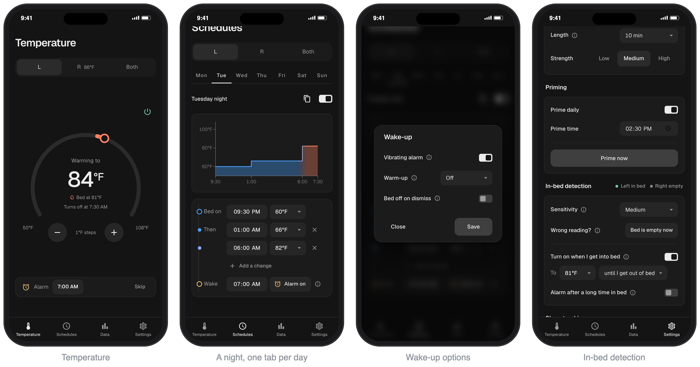

# EightPod — subscription-free, open-source local control for Eight Sleep Pods, in place of the cloud

<p align="center">
  
</p>

<p align="center">
  <a href="CHANGELOG.md"></a>
  <a href="https://github.com/jalen-cheng/eightpod/actions/workflows/ci.yaml"></a>
  <a href="LICENSE.md"></a>
  <a href="https://eightpod.vercel.app"></a>
  <a href="#compatibility"></a>
  <a href="DEVELOPING.md"></a>
</p>

EightPod controls an Eight Sleep Pod from your own network. Each Pod has a small Linux computer
inside; EightPod installs a server on it that talks to the Pod's firmware and serves a web app
you open on your phone.

It started as a fork of [Free Sleep](https://github.com/throwaway31265/free-sleep) by
throwaway31265 and its contributors, and grew into a rework: the Pod 5's side buttons, calibrated
temperatures, in-bed detection, a redesigned app, a schedule built around one night at a time,
alarms that run until you dismiss them, and an address you can remember (`http://eightpod.local`). It
was developed and tested on one Pod 5.

**Local, with no catch.** No cloud, no account and no subscription. The Pod is blocked from the
internet, so nothing is sent to Eight Sleep or anyone else, and the bed keeps working when your
internet does not.

<table>
  <tr>
    <td align="center" width="130"><a href="https://eightpod.vercel.app">Demo</a></td>
    <td align="center" width="130"><a href="INSTALLATION.md">Install</a></td>
    <td align="center" width="130"><a href="docs/USING.md">App guide</a></td>
    <td align="center" width="130"><a href="docs/HOW_IT_WORKS.md">How it works</a></td>
    <td align="center" width="130"><a href="docs/IOS_SHORTCUTS.md">Shortcuts</a></td>
    <td align="center" width="130"><a href="server/API.md">API</a></td>
    <td align="center" width="130"><a href="#faq">FAQ</a></td>
    <td align="center" width="130"><a href="CHANGELOG.md">Changelog</a></td>
  </tr>
</table>

## Install

You need a Pod 3, 4 or 5, about two hours, and $20 to $70 of parts: a USB serial adapter, plus
either a tag-connect cable or three soldered wires. The one hands-on step is opening the Pod's hub
and attaching the adapter to get a root shell; the [install guide](INSTALLATION.md) has photos for
each Pod. Then, on the Pod:

```bash
/bin/bash -c "$(curl -fsSL https://raw.githubusercontent.com/jalen-cheng/eightpod/main/scripts/install.sh)"
```

P.S. If you are in San Francisco and want to borrow the cable and adapter I used for my install,
I am happy to lend them out :) Open an [issue](https://github.com/jalen-cheng/eightpod/issues) to ask.

### Already running Free Sleep

No cable and no opening the hub. Over SSH, lift the internet block, run the same installer, and
block again. Settings and schedules are kept, and going back is one command:

```bash
sh /home/dac/free-sleep/scripts/unblock_internet_access.sh
```
```bash
/bin/bash -c "$(curl -fsSL https://raw.githubusercontent.com/jalen-cheng/eightpod/main/scripts/install.sh)"
```
```bash
sh /home/dac/free-sleep/scripts/block_internet_access.sh
```

Read [what changes](docs/POD_MODELS.md#things-to-know-before-updating-from-the-original) first; the
[install guide](INSTALLATION.md#coming-from-free-sleep) has the same steps with checks.

## Quick start

1. Open `http://eightpod.local` on a phone on the same Wi-Fi. The installer names the Pod `eightpod`. If it
   does not load (some Android phones and Linux computers do not look up `.local` names), use
   `http://<pod-ip>:3000`.
2. In **Settings**, set your time zone. Until you do, every scheduled time is off by hours.
3. In **Schedules**, set when the bed turns on, the temperatures through the night and when you wake.
4. Block the Pod from the internet (step 16 of the install guide), then close the hub.

No Pod yet? **[eightpod.vercel.app](https://eightpod.vercel.app)** is the app on made-up data.

## How it works

- The **firmware** is Eight Sleep's own program. It runs the pumps, heaters and vibration motors, and is left as it is.
- The **server** (`server/`) takes the place of Eight Sleep's cloud: it tells the firmware what to do, runs the schedule and alarms, and reads the buttons and the bed's sensors.
- The **app** (`app/`) is a web page the server serves. Add it to your phone's home screen and it behaves like an app.
- **Shortcuts and automations** use the same [local API](server/API.md) the app does.
- Away from home, optional **[Tailscale on the Pod](docs/REMOTE_ACCESS.md)** reaches it privately, with the internet block still on.

[HOW_IT_WORKS.md](docs/HOW_IT_WORKS.md) explains every part and how they interact.

## What it changes

**The big ones**

- **Wake-up heat.** The bed warms to a temperature you choose 15 to 45 minutes before the alarm, so you wake warm instead of being shaken out of a cold bed.
- **Alarms that wake you.** They run until dismissed with a real ramp-up on a Pod 5, can be changed for one morning without touching the schedule, and go off even if the bed is off.
- **Nights that run themselves.** Set bed-on, temperature changes and a wake time once per day of the week. The bed turns off 30 minutes after you wake, or the moment you dismiss the alarm.
- **In-bed detection (Pod 5).** The bed knows when someone is in it, and can turn on when you get in, off after you get out, or vibrate after a long stay.
- **Pod 5 side buttons work.** + and - change the temperature, holding the middle button switches the side on or off, and any button stops an alarm.
- **Temperatures are calibrated.** The number shown is what the firmware aims for at each level, measured on a Pod 5, beside the temperature the bed measures. Units are °F, °C, or Eight Sleep's -10 to +10.
- **Networking.** The app opens at `http://eightpod.local`. The internet block keeps the clock and name lookups working and is restored at every boot, and optional Tailscale reaches the Pod from anywhere with the block still on.

**Also**

- **A redesigned app.** Dark, phone-first and quiet: one screen per night with a chart, explanations behind an "i", and controls that respond at once.
- **Two sleepers.** Each side has its own temperature, schedule and alarm, or link the sides and control the bed as one.
- **Shortcuts and an API.** One request sets the temperature, sets an alarm by time ("6:30 AM" works), or reads the bed in a sentence, from iPhone Shortcuts or anything else that sends web requests.
- **Updates from the app.** It shows when a newer version exists and updates in about four minutes, putting the old version back if anything fails.
- **Housekeeping.** Daily priming at 2 PM, a daily reboot with its own switch, left and right can be flipped, and Eight Sleep's updater can be locked out.

Everything else, and the full comparison with Free Sleep, is in [CHANGELOG.md](CHANGELOG.md#compared-with-free-sleep).

## Security

- **The app has no login.** Anyone on your home network can open it. Never put it on the open internet; use [Tailscale](docs/REMOTE_ACCESS.md) to reach it from elsewhere.
- **The internet block** stops the Pod reaching Eight Sleep or anything else, and is restored at every boot. EightPod has no error-reporting destination built in.
- **You need root on the Pod once**, through a serial adapter. It is not supported by Eight Sleep and may affect your warranty. A Pod 3 or 4 can be put back with a firmware reset. **A Pod 5 cannot currently be put back to stock**; see the [FAQ](#faq).

## Compatibility

| Pod | Status |
|---|---|
| Pod 5 | Tested on one unit. Some newer units cannot be opened up the way the install guide needs; the guide says how to tell. |
| Pod 4 | Same code as the original project in the hardware paths, with the differences in [docs/POD_MODELS.md](docs/POD_MODELS.md). **Not run on a Pod 4.** |
| Pod 3 (with or without SD card) | As Pod 4: reviewed against the original, **not run**. |
| Pod 1, Pod 2 | Not compatible. |

## Status

On the test Pod 5: install and update, temperature and power, the measured temperature curve,
schedules, alarms with the stepped ramp, one-time alarms and the bed staying on for them, buttons,
linked sides, shortcuts, the internet block, the `.local` name, Tailscale on the Pod (from a phone
on cellular), in-bed detection and the bed turning on when someone gets in.

Not yet seen working on a Pod: the bed turning off after someone gets out, the long-stay alarm,
"ignore the schedule" after turning on by hand, and flipping left and right. Nothing has been run
on a Pod 3 or Pod 4. [CHANGELOG.md](CHANGELOG.md) keeps the full list.

**Biometrics are untested.** Sleep tracking, heart rate and the other measurements on the Data
page are Free Sleep's code, unchanged, and off unless you enable them. They produced nothing on
the test Pod 5 and were not looked into further.

## FAQ

Select a question to open its answer.

<details>
<summary><b>Is it reversible?</b></summary>

On a Pod 3 or Pod 4, yes: a firmware reset puts the Pod back as it left the factory, and it works
with Eight Sleep's app again. On a Pod 5, treat it as not reversible for now. Nobody has
established how to reset one, and the software-only way back in the
[install guide](INSTALLATION.md#going-back-to-eight-sleep) has not been tried.

<br>

</details>

<details>
<summary><b>Will I brick my Pod?</b></summary>

The install does not touch the firmware that runs the bed; it adds a program beside it and
switches a few services off. The risk is in the steps before that: you open the hub and type
commands as root, and a wrong command can stop the Pod booting. Follow the guide step by step and
do not improvise. A Pod 3 with an SD card is the riskiest, because the card itself is modified.

<br>

</details>

<details>
<summary><b>Will it void my warranty?</b></summary>

It may. EightPod is not supported by Eight Sleep. Opening the hub is visible to anyone who looks,
and a Pod 5 cannot currently be put back to stock.

<br>

</details>

<details>
<summary><b>Do I still need an Eight Sleep subscription or account?</b></summary>

No. Nothing here talks to Eight Sleep. Their app stops working with the Pod once it is installed.

<br>

</details>

<details>
<summary><b>Does it work without internet?</b></summary>

Yes. The Pod is blocked from the internet on purpose and everything runs on it. You need your
home Wi-Fi to reach the app from your phone, and the side buttons and schedule work without that.

<br>

</details>

<details>
<summary><b>How do I update?</b></summary>

The app shows when a newer version is out. **Settings > Device > Update** takes about four
minutes, keeps your settings, and puts the old version back if anything fails. The internet block
is lifted for the download and put back afterwards.

<br>

</details>

**More questions**

<details>
<summary><b>Can I control it away from home?</b></summary>

Yes, with [Tailscale on the Pod](docs/REMOTE_ACCESS.md). It is optional, takes one script, and
keeps the internet block on. A shortcut can open the app at home and offer Tailscale when you are
away.

<br>

</details>

<details>
<summary><b>Does sleep tracking work?</b></summary>

Not on a Pod 5: its firmware publishes sensor data where the analysis does not read. On a Pod 3 or
4 the code is the original's, unchanged and untested here. Help is [wanted](https://github.com/jalen-cheng/eightpod/issues).

<br>

</details>

<details>
<summary><b>Does the bed know when I am in it?</b></summary>

On a Pod 5, yes. It can turn on when you get in, turn off about 15 minutes after you get out, and
vibrate if you have been in bed longer than you chose. A Pod 3 or 4 does not report the sensors
this needs.

<br>

</details>

<details>
<summary><b>Do the buttons or taps on the bed work?</b></summary>

Pod 5 buttons do: + and - for temperature, hold the middle to switch a side on or off, any button
to stop an alarm. Pod 4 taps are handled by the same code and have not been run. A Pod 3 has
neither.

<br>

</details>

<details>
<summary><b>Two of us share the bed. Does each side get its own settings?</b></summary>

Yes: its own temperature, schedule and alarm. Or link the sides and control the bed as one.

<br>

</details>

<details>
<summary><b>Can I go back to the original Free Sleep?</b></summary>

Yes. One command over SSH reinstalls it and keeps your schedules; see
[docs/POD_MODELS.md](docs/POD_MODELS.md).

<br>

</details>

## Documentation

| Goal | Start here |
|---|---|
| Install it on a Pod | [INSTALLATION.md](INSTALLATION.md) |
| App guide: a night, alarms, settings | [docs/USING.md](docs/USING.md) |
| Know what works on a Pod 3 or Pod 4 | [docs/POD_MODELS.md](docs/POD_MODELS.md) |
| Keep the address stable, or reach the Pod away from home | [docs/REMOTE_ACCESS.md](docs/REMOTE_ACCESS.md) |
| Control the bed from iPhone Shortcuts | [docs/IOS_SHORTCUTS.md](docs/IOS_SHORTCUTS.md) |
| Understand every part and how they interact | [docs/HOW_IT_WORKS.md](docs/HOW_IT_WORKS.md) |
| Use the API | [server/API.md](server/API.md) |
| See what changed and what was tested | [CHANGELOG.md](CHANGELOG.md) |
| Help test or contribute | [CONTRIBUTING.md](CONTRIBUTING.md) |

## Development

```bash
git clone https://github.com/jalen-cheng/eightpod.git
cd free-sleep/app && npm install && VITE_ENV=demo VITE_USE_MSW=true npx vite
```

That runs the app on made-up data, with no Pod. Running against a Pod, the checks and how
releases work are in [DEVELOPING.md](DEVELOPING.md). The folders, services and commands on the Pod
keep the name `free-sleep`, so an existing install updates in place.

## Contributing

Issues and pull requests are welcome, within a few rules: nothing that sends data off the Pod or
needs the cloud, one change per pull request, and a test where the code can be tested. The most useful contribution is a report from hardware Free
Pod has not seen: a Pod 3 or Pod 4, or a newer Pod 5. [CONTRIBUTING.md](CONTRIBUTING.md) says how,
and issues labelled [needs testing](https://github.com/jalen-cheng/eightpod/issues?q=is%3Aissue+is%3Aopen+label%3A%22needs+testing%22)
list what is waiting to be checked.

## Credits

EightPod exists because of Free Sleep. Its community, support and donations are its author's:

- **[throwaway31265/free-sleep](https://github.com/throwaway31265/free-sleep)**, the original project, with its Discord server linked from its README. To support the original author, use the donation links there.
- [@bobobo1618](https://github.com/bobobo1618), for the research into how the Pod is controlled through `dac.sock`.
- The original's error monitoring is sponsored by Sentry. EightPod does not use it.

## License

See [LICENSE.md](LICENSE.md).
