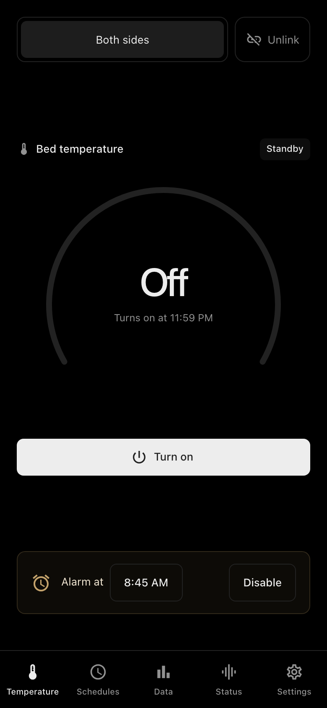
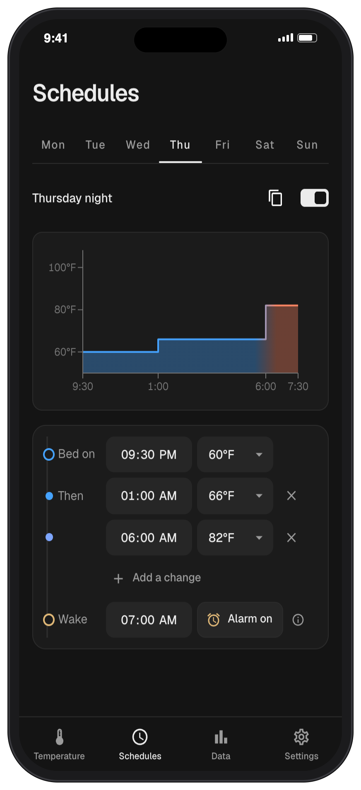
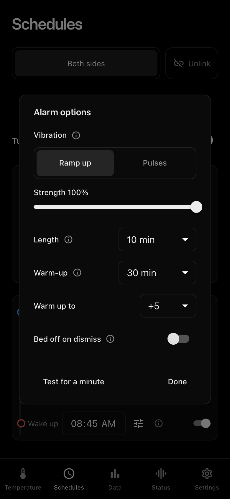
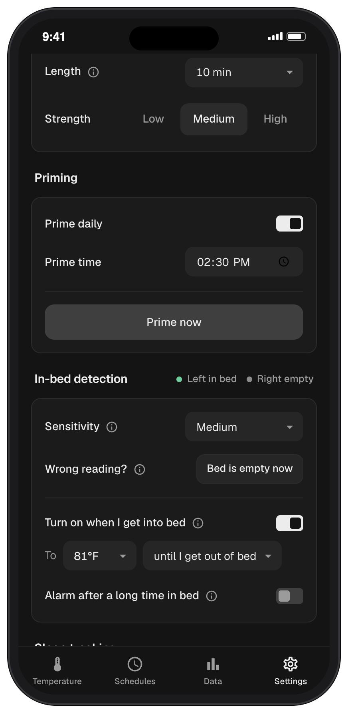

# Free Sleep: local control for Eight Sleep Pods

Free Sleep lets you control an Eight Sleep Pod from your own network, with no cloud and no
subscription. Each Pod has a small Linux computer inside. Free Sleep installs a server on it that
talks to the Pod's firmware, and serves a web app you open on your phone or computer.

This repository is a fork of [throwaway31265/free-sleep](https://github.com/throwaway31265/free-sleep),
the original project by its author and contributors. The fork was **built and tested on one Pod 5**.
It adds Pod 5 support the original lacks and changes how schedules and alarms work.

<table><tr>
<td align="center"> Temperature</td>
<td align="center"> A night, one tab per day</td>
<td align="center"> Alarm options</td>
<td align="center"> In-bed detection</td>
</tr></table>

Screenshots are from the test Pod 5, 17 Nov 2026.

## Where to go

| If you want to | Read |
|---|---|
| Install it on a Pod | [INSTALLATION.md](INSTALLATION.md) |
| Use the app: set a night, alarms, settings | [docs/USING.md](docs/USING.md) |
| Know what works on a Pod 3 or Pod 4 | [docs/POD_MODELS.md](docs/POD_MODELS.md) |
| Keep the Pod's address stable, or reach it away from home | [docs/REMOTE_ACCESS.md](docs/REMOTE_ACCESS.md) |
| Control the bed from iPhone Shortcuts | [docs/IOS_SHORTCUTS.md](docs/IOS_SHORTCUTS.md) |
| Understand how every part works and interacts | [docs/HOW_IT_WORKS.md](docs/HOW_IT_WORKS.md) |
| Use the API | [server/API.md](server/API.md) |
| See what changed, and what was tested | [CHANGELOG.md](CHANGELOG.md) |
| Work on the code | [DEVELOPING.md](DEVELOPING.md) |

## Which Pods

| Pod | Status |
|---|---|
| Pod 5 | Tested on one unit. Some newer units cannot be opened up the way the install guide needs; the guide says how to tell. |
| Pod 4 | Same code as the original project in the hardware paths, with the differences in [docs/POD_MODELS.md](docs/POD_MODELS.md). **Not run on a Pod 4.** |
| Pod 3 (with or without SD card) | As Pod 4: reviewed against the original, **not run**. |
| Pod 1, Pod 2 | Not compatible. |

## Things to know before using it

- **You need to open the Pod's hub and attach a serial adapter once** to get root access. It is
  reversible on a Pod 3 and Pod 4 with a firmware reset; a reset procedure for a Pod 5 is not
  documented here.
- **It is not supported by Eight Sleep** and may affect your warranty.
- **Sleep tracking (Biometrics) does not work on the tested Pod 5.** Its firmware publishes sensor
  data where the analysis does not read. Heart rate was validated by the original project on
  earlier Pods; that code is unchanged here.
- **The app has no login.** Anyone on your home network can open it. Do not put it on the open internet;
  [docs/REMOTE_ACCESS.md](docs/REMOTE_ACCESS.md) has a private way to reach it from elsewhere.
- **Nothing is sent anywhere.** The internet block stops the Pod reaching Eight Sleep or anyone
  else, and this fork has no error-reporting destination built in.
- **Updating from the original project changes some behaviour**: saved temperatures are converted
  once, and the bed's off time now follows the wake-up time. [docs/POD_MODELS.md](docs/POD_MODELS.md) lists them.

## What is different from the original project

| Area | Original | This fork |
|---|---|---|
| **Pod 5 side buttons** | Do nothing | + and - change the temperature and switch an off side on. Holding the middle button two seconds switches the side on or off. Any button stops an alarm |
| **Temperatures** | Levels spread evenly over 55 to 110°F | What the firmware aims for at each level, measured on a Pod 5: 50 to 108°F. The page also shows the temperature the bed measures |
| **Display units** | °F or °C | °F, °C, or the -10 to +10 scale of Eight Sleep's app |
| **Both sides at once** | Each side set separately | Link the sides: temperature, power, schedules, buttons and shortcuts apply to both |
| **A night's schedule** | Power on and off times, temperature changes and an alarm, set separately | Bed-on time, temperature changes and a wake-up time, as one list with a tab per day. No off time: the bed turns off 30 minutes after wake-up |
| **Alarm length** | Up to 3 minutes | Until dismissed, for 10 to 30 minutes |
| **Alarm ramp-up** | The firmware's "rise" pattern, which on a Pod 5 is one steady strength | On a Pod 5, a real ramp: 20, 40, 60, 80% of the chosen strength, then full |
| **Before the alarm** | Nothing | Optional warm-up to a chosen temperature 15, 30 or 45 minutes before |
| **After the alarm** | Bed stays on until its off time | Bed turns off 30 minutes after the wake-up time, or the moment the alarm is dismissed |
| **One-time alarm** | Overrides tonight's alarm | Set in the app or by one request. Replaces that morning's alarm, goes off even if the bed is off, and the bed stays on for it |
| **Two sleepers' alarms** | Dismissing one stops both, so the other is lost | Linked sides stop together; otherwise the other side's alarm starts again |
| **In-bed detection** (Pod 5) | None | Knows when someone is in bed. Optionally turns the bed on when you get in, and vibrates after a long stay |
| **Turning on by hand** | Stays on 12 hours | 3, 6 or 12 hours, and can ignore the schedule meanwhile |
| **Left and right** | As the firmware has them | Can be flipped in Settings |
| **iPhone Shortcuts** | Possible with the general API | Short requests: set by -10..+10, set an alarm by time ("6:30 AM" works), read the bed in one sentence |
| **Opening by name** | Blank page under any name | `http://eight-pod.local:3000` at home; the Tailscale name away |
| **Internet block** | Also blocks DNS, which can stop the clock syncing | DNS, address requests and time sync keep working; restored at every boot; Eight Sleep's updater can be locked out |
| **Remote access** | None | Optional Tailscale on the Pod, set up by one script, with the block still on |
| **Updates** | From the original project | From this fork; the app shows when a newer version exists |
| **Housekeeping** | Daily priming off by default; daily reboot only while priming is on | Daily priming on at 2 PM by default; the daily reboot has its own switch |

Smaller changes: temperature controls respond at once instead of locking after every press; the
power button waits for the Pod's real state; alarm options has a one-minute test; a schedule can be
saved for one day or any set of days; snooze was removed (the original stored the setting and never
acted on it).

Fixes offered back to the original project, each small and standing on its own:
[#67](https://github.com/throwaway31265/free-sleep/pull/67),
[#68](https://github.com/throwaway31265/free-sleep/pull/68),
[#69](https://github.com/throwaway31265/free-sleep/pull/69),
[#70](https://github.com/throwaway31265/free-sleep/pull/70),
[#72](https://github.com/throwaway31265/free-sleep/pull/72),
[#73](https://github.com/throwaway31265/free-sleep/pull/73),
[#74](https://github.com/throwaway31265/free-sleep/pull/74).

## What has and has not been tested

On the test Pod 5: install and update, temperature and power, the measured temperature curve,
schedules, alarms with the stepped ramp, one-time alarms and the bed staying on for them, buttons,
linked sides, shortcuts, the internet block, the `.local` name, Tailscale on the Pod (from a phone
on cellular), in-bed detection and the bed turning on when someone gets in.

Not yet seen working on a Pod: the bed turning off after someone gets out, the long-stay alarm,
"ignore the schedule" after turning on by hand, and flipping left and right. Nothing has been run
on a Pod 3 or Pod 4. [CHANGELOG.md](CHANGELOG.md) keeps the full list.

## Help and contributing

Open an issue or pull request on [this repository](https://github.com/jalen-cheng/free-sleep).
Reports from a Pod 3 or Pod 4 are especially useful. [DEVELOPING.md](DEVELOPING.md) covers setup
and checks.

## The original project

This fork exists because of the original Free Sleep. Its community, support and donations are its
author's, not this fork's:

- [throwaway31265/free-sleep](https://github.com/throwaway31265/free-sleep), with its Discord
  server and support bot linked from its README. They describe the original's behaviour, which
  differs from this fork's in the ways listed above.
- To support the original author, use the donation links in the original's README.
- The original's error monitoring is sponsored by Sentry. This fork does not use it.
- Thanks to [@bobobo1618](https://github.com/bobobo1618) for the research into how the Pod is
  controlled through `dac.sock`.

## License

See [LICENSE.md](LICENSE.md).
