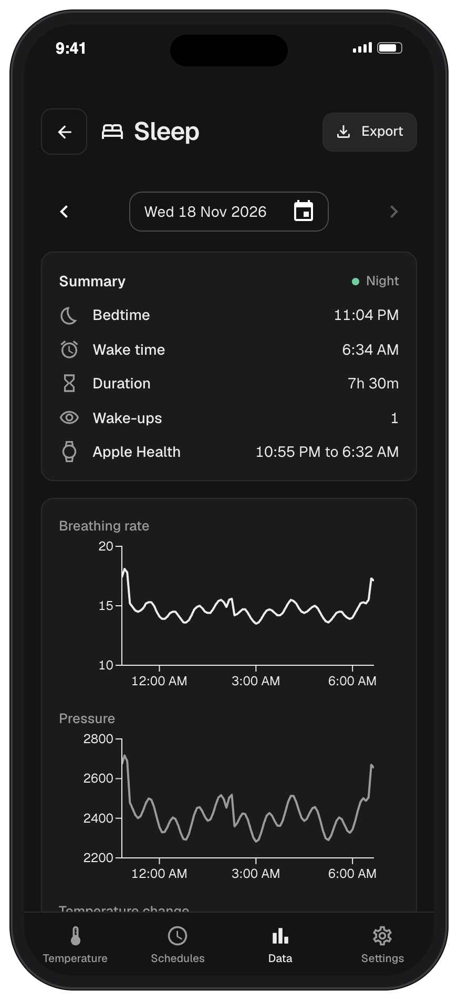

# Autopilot (Pod 5, experimental)

Off by default. Switch it on in **Settings > Autopilot > Adjust the temperature while I sleep**.
While someone is asleep, it moves the bed a few degrees around the temperature the schedule set.

**Not yet run through a real night.** It is covered by tests and by made-up nights run against
the built server. [Trying it without a night](#trying-it-without-a-night) has a 20-minute test
you can run on the bed at any hour.

Where the sensors could be wrong, it is built to do little, not to guess: the rules below hold
whatever the sensors say.

## The rules it keeps

- **One sleeper, whole bed.** It takes the bed to be one sleeper's. Switching it on links the
  two sides, and unlinking them switches it off. Each side is still sensed and saved on its own.
- **Never more than 4°F** from the schedule's temperature, **one degree at a time**, at most one
  change every 10 minutes, with no exceptions. When the schedule changes its temperature, the
  schedule moves the bed as it always does, and the autopilot walks its offset back in over the
  next few steps. Each side moves from where it is, so sides that were set apart meet a degree
  at a time and never jump.
- **Your hand wins.** A temperature you set (app, side buttons, a request to the API), on
  either side, is held exactly as you set it, until the schedule's next change or the end of
  that third of the night, whichever comes first. The autopilot then carries on, a degree at
  a time.
- **What you set before falling asleep stays.** If you set the bed to something other than the
  schedule's temperature before you slept, that is what the night's offset is counted from,
  until the schedule's next change.
- **It leaves alone** a side that is off (setting a temperature never switches one on), away
  mode, the wake-up heat, and a manual temperature that is holding the schedule back.
- **The night ends at the wake-up time.** From then the bed is the schedule's and the alarm's
  again, and the autopilot does not start another night until the bed has been empty.
- **It cleans up.** When a night ends (the wake-up time, the bed empty for 30 minutes, or the
  autopilot switched off), it takes its offset back out of each side still set to what it
  last put there. A temperature you have set since is left alone. If the Pod cannot be reached
  at that moment it tries again the next minute, and after a restart it does so even if the
  sensors are silent.
- **It only asks for temperatures the bed has.** The bed takes about two hundred settings, not
  every whole degree; near its coldest, the next setting down is nine degrees away, and the
  autopilot stays where it is before it goes past what it wants.
- **A restart does not start the night over.** The night under way is saved; after an update
  or reboot it carries on from the same point if someone is still in bed.
- **Once the night has begun it runs by the clock.** Stirring for a few minutes does not send
  the bed back to the set temperature and down again.

## What adds up to the offset

| Part | What happens | Size |
|---|---|---|
| Your changes | How far a temperature you set was from what the autopilot wanted is partly remembered for that third of the night | 0.3 of it each time, up to ±3°F |
| Night curve | Cooler from falling asleep through the first half of the night, back to the set temperature by about 85% of the way to the wake time, then a little warm | -2°F, then 0, then +1°F |
| First sleep cycle | A little cooler from 20 to 90 minutes after falling asleep. Deep sleep itself is not detected | -1°F |

When these add up to more than 4°F, they are cut from the bottom of the table up, so what you
taught it is the last to go.

**The room is not acted on yet.** The code can cool the bed as the room warms (half a degree
per degree, ±2°F), but the only air reading is at the cover, which may warm with the sleeper
as much as with the room. Acting on it could cool the bed every night for no reason, so it is
saved with each minute and left out of the offset until logged nights show what it follows.

**Learning.** At 0.3, a one-degree change takes two nights that agree before it shows. A change
is counted once per hold, not once per button press, and for no more than 4°F however large it
was, so one odd night teaches it a little over a degree at most. What it has learned stays
until you correct it the other way. Any request that
sets the temperature counts as yours, including one from an automation of your own. The one
exception is the bed turning itself on when you get in (In-bed detection): that temperature is
held like any other but teaches nothing, since it is a rule and not tonight's choice.

The night runs from falling asleep to that night's wake-up time (8 hours if the night has no
schedule). The base temperature is the schedule's: the bed-on temperature, then each scheduled
change as it comes up. If you had set the bed yourself before falling asleep, yours is the
base until the schedule's next change. At an hour the schedule does not cover, the base stays
what it last was (the bed's own setting at sleep onset if the schedule never covered the
night); it never falls back to an earlier temperature part-way through.

**If your schedule already cools early and warms late,** the curve adds to that. Your own
changes will pull it back over a few nights, but the simpler fix is a flat schedule.

## How much of this is evidence

Less than the first version of this page claimed. The studies show that taking heat from the
body in sleep can change sleep; none tested this curve, these sizes, or a water-cooled cover
set in degrees.

| Study | What it found | What it does not show |
|---|---|---|
| Kräuchi et al. 2018, Physiol Behav 185:23 | 15 young men, randomised crossover, a passive mattress that draws heat away: 16% more slow-wave sleep, in the second part of the night | An early cooling pulse; anything about a setpoint |
| Herberger et al. 2024, Sci Rep | The same kind of passive mattress: deep sleep up 7.5 minutes a night, give or take 21.6, heart rate down 2.4 bpm, the gain building after about four hours | That cooling early in the night is the part that matters |
| Moyen et al. 2024, Bioengineering 11:352 | Eight Sleep's own study, 54 people, a week off then a week on, not randomised, each choosing their own temperatures: 14 more minutes of deep sleep in men who slept cooler in the first half | That any given curve beats the schedule a sleeper already likes |
| Raymann et al. 2008, Brain 131:500 | Warming the skin by 0.4°C with a thermosuit cut waking in the night | That a degree of water temperature does the same |

So the curve is a starting guess to test against your own nights, and your corrections are the
part most likely to be right. Nothing here measures whether the autopilot improves sleep; the
saved nights record whether it steered, so nights with and without it can be compared later.

**The room reading is unproven, so it is not used.** It comes from the sensor at the cover,
which may read the sleeper as well as the room. Each saved minute has it, the air temperature
at the hub on the floor and the mattress surface, so a few nights will show which one follows
the room. The mattress surface is deliberately never acted on: it follows the water, so the
autopilot would be answering its own changes.

## How it tells you are asleep

By stillness, the way a wrist tracker's movement sensor does. The cover's piezo sensor (500
readings a second per side, on the firmware's sensor bus) feels movement; each minute is summed
up as a count of seconds with movement, and two rules decide the state
(`server/src/autopilot/sleepTracker.ts`):

- **Asleep:** in bed and still for 15 minutes in a row. Sleep is counted from when the
  stillness began; the bed can only act on it once the 15 minutes are up.
- **Awake again:** 3 minutes out of 5 with 12 or more moving seconds each. A turn in bed, or
  two, is not waking.

Movement is judged against the sleeper's own quiet level over the last quarter of an hour, so
a whole minute of fidgeting counts as movement and not as the new normal. A minute in which the
sensor sent too little, or a dead flat line, is not counted as lying still, so a sensor that
stops is not taken for a sleeper. Lying awake and still does read as
asleep, which is the known weak point of judging by movement.

A heart rate is read from the same sensor, saved and shown, and decides nothing yet. Deep sleep
is not detected.

**Breathing.** Each breath is a slow swell in the piezo signal. Every 10 seconds the last 30
are averaged down to 10 readings a second, drift and heartbeats are taken out, and the rate is
the shift at which that slow signal best matches itself, between 8 and 30 breaths a minute
(`server/src/autopilot/breathingRate.ts`). Each minute's rate, and how far apart its readings
were, are saved with the night. On this Pod it read 17 to 18 breaths a minute for a sleeper
lying still and awake, who breathes 14 to 16 asleep by their watch. That fits, and is one
person on one evening.

What breathing can tell, from sleep-lab studies:

- The rate barely moves: 16.8 breaths a minute awake against 15.2 to 15.9 in every sleep stage,
  in 38 adults who differed from each other by 2 to 3 (Gutierrez et al. 2016, Physiol Rep
  4:e12949). No range of rates marks sleep.
- Its steadiness does: variability is highest awake and in REM and falls into deep sleep. So
  the bed measures the spread of its readings, not the rate. That spread is of 30-second
  estimates, which is not the same thing as the breath-to-breath variability the studies
  measured, and has yet to be shown to follow it.
- No published rule turns either into "asleep" or "deep sleep". Systems with figures use a
  trained model on breathing and movement together (93% for asleep against awake by radar,
  about 71% of deep sleep found: Diao et al. 2026, arXiv 2604.16442).

So steady breathing is not asked for by default. It is one of the things calibration against a
sleep tracker tries, and it is only switched on when that makes the bed agree better with the
tracker on nights it was not fitted to.

**Getting up in the night.** Less than 30 minutes out of bed is the same night.

**Naps.** A sleep of under 3 hours is a nap; that is how saved sleeps are sorted. Nobody knows
how long a sleep will last when it begins, so whether the autopilot steers it from the start
goes by when it began:

1. against when you have actually been falling asleep and waking, from your newest 14 saved
   nights (once there are 3). The schedule's times are when the bed runs, not when you sleep;
2. with too few saved nights, against the schedule's bedtime and wake-up time;
3. with neither, by the hour: between 9:00 and 19:00 looks like a nap.

A sleep that begins up to 3 hours before your usual time, or any time until your usual waking,
is steered from the start. Any other is left alone, and if it is still going after 3 hours the
autopilot takes over from there.

## Trying it without a night

**Settings > Autopilot > 20-minute test > Start** plays a whole night's plan on the bed in 20
minutes, from the temperature it is set to now. The bed has to be on and the autopilot switched
on; nobody needs to be in it. The same code that runs a night runs the test, on a clock 24
times as fast, so what you watch is what a night would do to the bed's setting:

- about a degree a minute down to 3°F cooler, back up through the set temperature, a degree
  warm at the end, then back to where it started;
- never more than 4°F from where it started, never more than one degree in a step;
- change the temperature yourself part-way and it holds exactly what you set for a few minutes
  (a third of the test), then walks back a degree at a time;
- **Stop**, or switching the autopilot off, puts the bed back within a minute.

The line under the button says how long is left and what it last did and why. The water takes
longer than a minute to follow, so watch the target on the Temperature page, not the "Bed at"
reading. A test learns nothing from what you change, a restart ends it, and it gives way to the
schedule: if a scheduled temperature change, bed-on or bed-off time comes up while it runs, the
test ends and the bed is the schedule's. `POST /api/autopilot/rehearsal` starts one and `DELETE` stops it.

Sleep detection can be checked without the autopilot on, in about 20 minutes: lie down and
keep still. Settings > Autopilot shows "Awake" with your breathing rate, then "Asleep" once
you have been still for 15 minutes (lying awake and still reads as asleep, as said above), and
after 20 minutes in bed the stay is saved and shows under **Data > Sleep** as a nap.

## Linking a sleep tracker

A watch or band is a better judge of when you slept than the bed's own guesses, and its record
can be sent each morning so the bed fits its sleep rules to it: 5 nights, and only a fit that
does better on nights it was not fitted to is taken up. The link is an iPhone Shortcut that
reads Apple Health (Apple Watch, Whoop and Fitbit all write there).
[Connections](CONNECTIONS.md#link-apple-health) has the steps, and what is done with what is
sent.

## Where nights are kept

Every stay in bed of 20 minutes or more is saved on the Pod, whether or not the autopilot is
switched on, as one file in `/persistent/free-sleep-data/autopilot_nights/`: a row per minute
(moving seconds and the raw size of the movement signal, heart rate, breathing rate and spread,
pressure on the bed, state, what the bed was set to and its water temperature, the autopilot's
offset, the air at the cover and at the hub, the mattress surface), the bed's sleep
and wake times, whether the autopilot steered, and the tracker's record if one was sent. A
night is about 50 KB. The newest 180 files are kept (three months for two sides), under 10 MB
of the Pod's 14 GB free. An open stay is written every 10 minutes, so a restart loses at most
that, and starts a new file.

 Nights: a night's summary and its breathing rate">

**Data > Sleep** shows one day at a time, last night first, with arrows and a calendar to move:
bedtime, wake time, duration and wake-ups, then breathing rate, pressure on the bed and the
autopilot's temperature changes against the clock. A night belongs to the morning it ended on.
With the sides linked the bed is shown as one sleeper's, whichever side they lay on (where both
sides saw the same hours, the one with the most sleep); otherwise the side this device controls.
**Export** downloads the nights of the last week, two weeks, one, two or three months as one
JSON file. `GET /api/autopilot/nights` and `GET /api/autopilot/nights/export` return the same.
The biometrics service keeps its own sleep records in its database; these files are separate
and do not need it.

## Seeing what it does

Settings > Autopilot shows, while someone is in bed, whether they are asleep, their breathing
rate and the last change with its reasons. `GET /api/autopilot` returns the same (see
[server/API.md](../server/API.md#autopilot)), and the server log has a line for every change.
What it has learned is kept in `/persistent/free-sleep-data/autopilot_state.json`; delete the
file and restart SevenSleep to forget it.

## Code

`server/src/autopilot/`: `heartRate.ts` and `breathingRate.ts` (the estimates), `sleepTracker.ts`
(the sleep rules, and fitting them to a tracker), `nightPlan.ts` (curve, learning, room, limits,
steps, the test's clock), `scheduledBase.ts` (the schedule's temperature at a time, what a
night's offset is counted from, night or nap), `nightLog.ts`
(the saved nights), `autopilotMonitor.ts` (state, and the only file that touches the Pod). The
first five are pure and tested in `tests/autopilot.test.mjs`.

Two other open-source projects informed the rules above: Sleepypod's temperature controller
(manual targets are absolute and held, relative changes are worked out from the schedule and
never from the autopilot's own last setting, a temperature never switches a side on) and
Nightstand (learn slowly from repeated corrections).
