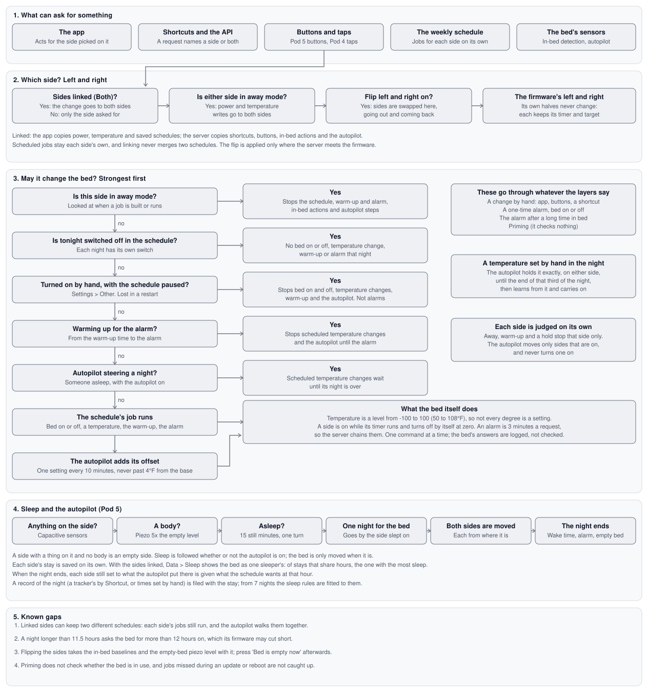
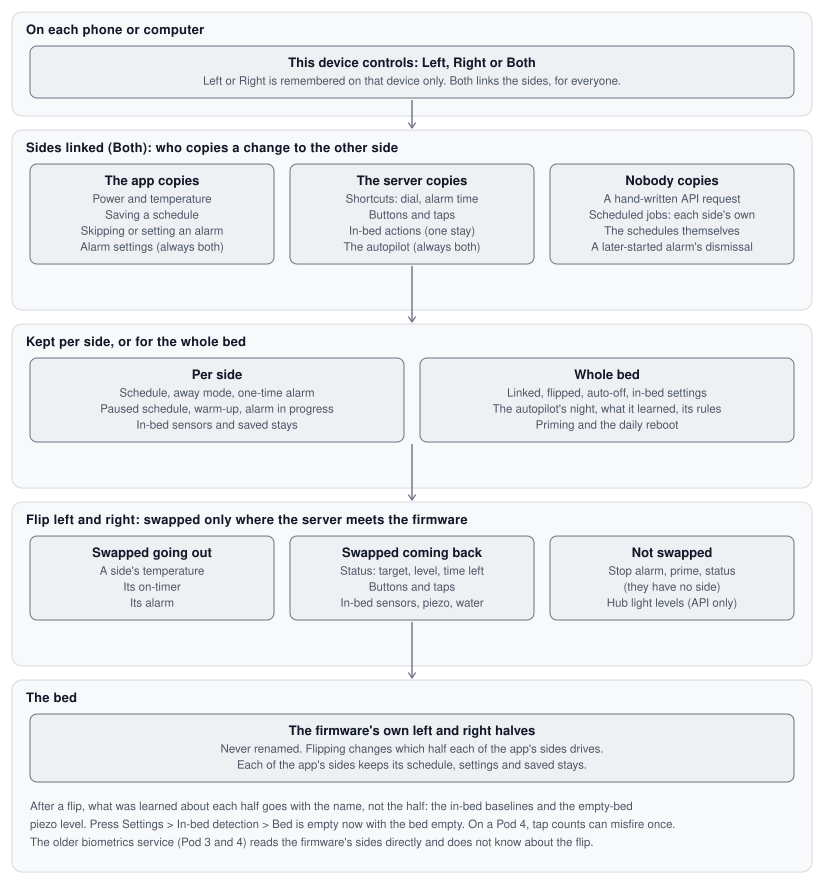

# How SevenSleep works

Everything that runs on the Pod, what each part does, and how the features affect each other.
What changed from the original project is in the [README](../README.md); SevenSleep builds on [throwaway31265/free-sleep](https://github.com/throwaway31265/free-sleep).
Written from the code on `main` on 17 Nov 2026. File references are for anyone who wants to check.

For how to use the app, see [USING.md](USING.md). For what changed in each version, see [CHANGELOG.md](../CHANGELOG.md).

The whole of it on one page: what can ask the bed for something, how a side is chosen, what can
stop a change, and how sleep is followed. [Open it full size](diagrams/system-logic.svg).

<a href="diagrams/system-logic.svg"></a>

- [1. The parts](#1-the-parts)
- [2. Where things are stored](#2-where-things-are-stored)
- [3. Temperature](#3-temperature)
- [4. The weekly schedule and its jobs](#4-the-weekly-schedule-and-its-jobs)
- [5. Alarms](#5-alarms)
- [6. Pod 5 buttons and Pod 4 taps](#6-pod-5-buttons-and-pod-4-taps)
- [7. Linked sides and away mode](#7-linked-sides-and-away-mode)
- [8. In-bed detection (Pod 5)](#8-in-bed-detection-pod-5)
- [9. Daily housekeeping: priming, reboot, calibration](#9-daily-housekeeping-priming-reboot-calibration)
- [10. The app, page by page](#10-the-app-page-by-page)
- [11. The API and phone shortcuts](#11-the-api-and-phone-shortcuts)
- [12. Network: the internet block, the name, Tailscale](#12-network-the-internet-block-the-name-tailscale)
- [13. Installing and updating](#13-installing-and-updating)
- [14. How features interact](#14-how-features-interact)
- [15. Flash wear](#15-flash-wear)
- [16. Known rough edges](#16-known-rough-edges)

## 1. The parts

| Part | What it is | Where |
|---|---|---|
| **Firmware** ("frank") | Eight Sleep's own program. It drives the pumps, heaters and vibration motors and is the only thing that touches hardware. | Already on the Pod |
| **SevenSleep server** | A Node program on ports 3000 and 80. It tells the firmware what to do, runs the schedule, and serves the app. | `server/` |
| **The app** | The web page you open. It only talks to the server. | `app/`, built into `server/public` |
| **Biometrics (legacy)** | The original project's sleep analysis, from before the autopilot: Python that turns sensor data into sleep and heart data. The autopilot does not use it. **Off on a Pod 5**: its firmware publishes that data where the analysis does not read. | `biometrics/` |
| **Scripts** | Install, update, the internet block, the `.local` name, Tailscale. | `scripts/` |

How the server reaches the firmware: SevenSleep opens a socket file (`dac.sock`) and the firmware
connects to it, the same way it would connect to Eight Sleep's cloud program. SevenSleep then sends
numbered commands one at a time and waits up to 10 seconds for each answer
(`server/src/8sleep/frankenServer.ts`). The commands it uses:

| Command | Used for |
|---|---|
| `DEVICE_STATUS` | Read both sides' levels, time left, water, priming, settings |
| `TEMP_LEVEL_LEFT` / `RIGHT` | Set a side's level, -100 to 100 |
| `LEFT` / `RIGHT_TEMP_DURATION` | Seconds a side stays on. The schedule asks for the night's length and 30 minutes, so the bed turns itself off if the server has stopped; 0 switches it off |
| `ALARM_LEFT` / `RIGHT` | Vibrate a side: strength, seconds, pattern |
| `ALARM_CLEAR` | Stop vibrating. The firmware stops **both** sides |
| `PRIME` | Run the water priming cycle |
| `SET_SETTINGS` | LED brightness and sensor gains |

A side is "on" when the firmware reports time left on its timer. There is no separate on/off flag.

At start-up the server loads its saved files, builds the schedule's jobs, starts listening on ports
3000 and 80, connects to the firmware, and starts two watchers: one polls the firmware's status (every
half second on a Pod 4 or 5), the other follows the firmware's log for Pod 5 button presses.

## 2. Where things are stored

Everything SevenSleep keeps lives in `/persistent/free-sleep-data/` on the Pod.

| File | Holds | Notes |
|---|---|---|
| `lowdb/settingsDB.json` | Time zone, display unit, link sides, side names (API only), away mode, button settings, daily priming and reboot, and the one-time alarm | Defaults: UTC, °F, daily reboot on, daily priming on at 14:00, sides not linked |
| `lowdb/schedulesDB.json` | For each side and each day: bedtime, off time, temperature changes, the alarm | See section 4 |
| `lowdb/servicesDB.json` | Biometrics and error-reporting switches and their status | |
| `free-sleep.db` | Sleep, heart and movement records (SQLite) | Only filled when biometrics works |
| `logs/` | Server log, update log, calibration logs | |
| `temperature_scale_version.txt` | Marks that saved temperatures were converted to the measured scale | See section 3 |
| `autopilot_nights/` | One file for each stay in bed: a row a minute, and the sleep and wake times (Pod 5) | The newest 180 are kept. See [AUTOPILOT.md](AUTOPILOT.md) |
| `autopilot_state.json` | What the autopilot has learned, its sleep rules, and a night under way | Delete it to start over |

**Any write to the settings or schedules file rebuilds every scheduled job.** The server watches the
folder and, on a change, cancels all jobs and creates them again from the files
(`server/src/jobs/jobScheduler.ts`). That is why a setting takes effect straight away, and why
nothing needs restarting. Things that are in progress (a vibrating alarm, a warm-up) are kept in
memory instead, so a rebuild does not interrupt them. A restart of the server or the Pod does lose
them.

## 3. Temperature

The firmware works in **levels from -100 to 100**. Eight Sleep's own app shows these as -10 to +10.
SevenSleep stores and sends whole **°F** everywhere and converts at the edges.

**The measured curve.** The original project assumed levels were spread evenly from 55 to 110°F.
On the test Pod 5 the firmware reports the water temperature it actually aims for, and it is not
even (`server/src/db/temperatureCurve.ts`):

| Level (dial) | Firmware aims for |
|---|---|
| -100 (-10) | 10.0°C / 50°F (this one level drops sharply) |
| -99 | 15.1°C / 59°F |
| 0 | 27.0°C / 81°F |
| +50 (+5) | 36.0°C / 97°F |
| +100 (+10) | 42.0°C / 108°F |

Between those points the line is straight. So the range is 50 to 108°F, and "level +5" is 97°F, not
96. These are the firmware's targets; whether the water reaches them is what the second
calibration run measures.

**Saved schedules were converted once.** A schedule saved under the old even scale kept its number
but would have meant a different level, so on first start with the new curve every saved
temperature was converted to keep its *level*. The originals are in
`schedulesDB.before-measured-temperatures.json`.

**Display units** (Settings > General > Temperature format): °F, °C (to half a degree), or **Level** (-10 to
+10, matching Eight Sleep's app). The dial moves a whole level at a time in Level, and a whole °F in
°F and °C.

**Setting a temperature.** The server turns °F into the nearest level and sends it. Turning a side
on by hand (app, shortcut or buttons) sets its timer to 3, 6 or 12 hours, chosen in Settings >
Other > Auto-off after; 12 is the default. The Temperature page waits 0.7 seconds after your last tap before
sending, so several taps become one request, and it ignores the Pod's reported value while you are
still tapping.

**Measured water temperature.** A Pod 5 also reports the water temperature it measures on each
side. The Temperature page shows it under the target ("Bed at 70°F"), and `/api/deviceStatus`
carries it as `measuredTemperatureF`. On a Pod that does not report it, the page shows the
firmware's own estimate as before ("Currently at"). In a two-hour run on the test Pod the water
settled within 2°F of the target from level -5 to +10; at the coldest level it reached 63°F
against a 50°F target in 20 minutes.

**The dial endpoints** exist for phone shortcuts: `POST /api/deviceStatus/dial {"dial": -3}` turns
the bed on at that level, and `GET /api/deviceStatus/dial` answers with a sentence such as "Both
sides set to -2, now at -3".

## 4. The weekly schedule and its jobs

Each side has seven entries, one per day. An entry describes **one night, named after the day it
starts on**:

| Field | Meaning |
|---|---|
| Schedule on | If off, the bed does not turn on or off by itself that night, and its alarm does not run |
| Bedtime, and its temperature | The bed turns on at this time, at this temperature |
| Temperature changes | Any number of "at this time, change to this" |
| Alarm | Time, pattern, strength, how long it keeps going, the warm-up, whether the bed turns off when it is dismissed |
| Wake-up time | Stored as the alarm's time, whether or not the alarm is switched on to vibrate |
| Off time | Never chosen: always 30 minutes after the wake-up time |

**Which calendar day a time belongs to.** Bedtime is on the entry's own day. Every other time is
compared with bedtime on the clock: earlier on the clock means the next day. With Monday's bedtime
at 22:00, a change at 23:00 is Monday night, a change at 01:00 and an alarm at 06:30 are Tuesday
morning (`getDayIndexForSchedule` in `server/src/jobs/scheduleTiming.ts`).

**The jobs** built from each entry, for each side:

| Job | When | What it does | Skipped when |
|---|---|---|---|
| Power on | Bedtime | Turns the side on at the bedtime temperature | Schedule off, or the side is away |
| Temperature change | Each change time | Sets the temperature. Does not turn the side on | Schedule off, side away, or a warm-up is running |
| Warm-up | Alarm time minus the warm-up minutes | Sets the warm-up temperature and holds off scheduled changes until the alarm | Schedule off, alarm off, away, the side is off at that moment, or a one-time alarm stands in for the alarm |
| Alarm | Alarm time | Starts the vibration (section 5) | Schedule off, alarm off, away, the side is off with nobody on it, or a one-time alarm stands in for it |
| Power off | Off time | Turns the side off, **unless an alarm is still to come** (section 5) | Schedule off, or away |

Jobs are per side. When the sides are linked, the app saves the same night to both sides, so both
sides' jobs do the same thing at the same time.

## 5. Alarms

### What a scheduled alarm does

1. **Warm-up** (optional, 15 to 45 minutes before): the bed goes to the warm-up temperature.
2. **Vibration starts** at the alarm time, if the side is on.
3. **Ramp up** (if the pattern is "Ramp up", on a Pod 5; a Pod 3 or 4 gets the firmware's own
   pattern, see [POD_MODELS.md](POD_MODELS.md)): 10 seconds each at 20%, 40%, 60% and 80% of the set
   strength, then full strength. "Pulses" starts at full strength.
4. **It keeps going** until dismissed, up to the length you chose (10, 15, 20 or 30 minutes).
5. **Dismiss it** with any button on a Pod 5, a four-tap on a Pod 4, the dialog in the app, or a
   request to the API.
6. The side turns off 30 minutes after the alarm time. If "Bed off on dismiss" is switched on in
   the alarm's options, it turns off the moment the alarm is dismissed instead.

### Why the vibration is sent in pieces

The firmware has three limits, all found by testing on the Pod:

- It vibrates for at most about **three minutes** per request.
- Its own "rise" pattern **does not ramp**: it is one steady strength.
- It **ignores a new request while it is vibrating**.

So SevenSleep sends one stretch at a time and, when a stretch is due to end, sends the next
(`server/src/jobs/alarmSession.ts`). A 30-minute ramp-up alarm at 100% is: 10 s at 20, 10 s at 40,
10 s at 60, 10 s at 80, then full strength in three-minute stretches until 30 minutes have passed.
There is a gap of about a second between stretches.

### Dismissing, and two sides

The firmware's stop command stops both sides. So:

- **Both sides began going off within a minute of each other:** it is one alarm. Dismissing
  either side dismisses both, and each side's "turn off when dismissed" applies. Linked sides
  always fall here.
- **The other side's alarm began at another time:** it is started again straight away. It starts
  over from the beginning, ramp included.
- A dismissal from a Pod 5's buttons is answered with a 2-second double buzz at quarter strength
  on the side that pressed.

"Turn off when dismissed" applies only to a dismissal. An alarm that runs to its full length
leaves the bed on until the off time.

### One-time alarms

Set from the Temperature page ("Change next alarm only"), or by a shortcut
(`POST /api/alarm/time {"time": "7:15 AM"}`). It is stored in the settings file as a time plus an
expiry, and the weekly schedule is not touched.

- It goes off at the next moment the clock shows that time: later today, or tomorrow.
- It goes off **even if the bed is off or the side is away**. It does not turn the bed on.
- Its pattern, strength, length and "turn off when dismissed" are taken from the alarm saved for
  that weekday.
- **It replaces the scheduled alarm of the same morning.** The scheduled alarm is skipped if it
  falls before the one-time alarm, or up to 6 hours after it. An afternoon one-time alarm therefore
  leaves tomorrow morning's alarm alone.
- **The warm-up moves with it.** The replaced alarm's warm-up is skipped, and the one-time alarm gets the
  same warm-up (that weekday's minutes and temperature) before its own time, if the bed is on then.
- **It moves the off time.** A side that is on turns off 30 minutes after the one-time alarm goes off.
- `{"shiftMinutes": 30}` moves the next alarm later (or earlier with a negative number) the same way.
- `POST /api/alarm/time/cancel` removes it. In the app, set the time back to the schedule's own.

### A one-time alarm later than the off time

A night's own alarm is never later than its off time, because the off time is 30 minutes after it.
A one-time alarm can be. If one is due within 6 hours after the off time, the power-off job does
not switch the side off: it sets the side's timer to run out two minutes after that alarm would
finish. When the alarm then goes off, the timer is set again, to 30 minutes. So the bed turns off
30 minutes after a one-time alarm, and the two-minute figure only matters if the alarm never fires.

## 6. Pod 5 buttons and Pod 4 taps

A **Pod 5** has three buttons per side: -, + and a middle button. The firmware does not report them
through the status the Pod 4 uses, but it writes each press to its log, so SevenSleep follows that
log (`server/src/8sleep/buttonMonitor.ts`). The server's user is given permission to read it by the
installer. A **Pod 4** reports double, triple and quadruple taps as counters, read by polling.

| Situation | Pod 5 | Pod 4 |
|---|---|---|
| Bed on, - or + | Cooler or warmer by the step set in Settings, per press | Double tap cooler, triple tap warmer |
| Bed off, - or + | Turns the side on. No temperature change | Changes the temperature setting |
| Middle button, short press | Nothing | (Four taps) turns the side on or off |
| Middle button, held 1 second | Turns the side on or off | Not available |
| Alarm vibrating | **Any** short press of any button dismisses it | Four taps dismiss it |

- Presses within 0.4 seconds of each other are handled together, so three quick presses move three steps.
- A second alarm or power press within 3 seconds is ignored, so one press is never counted twice.
- When the sides are linked, buttons on either side control both.
- The step is set in Settings > General. In Level the choices are 1, 2 or 3 levels.
- Snooze was removed. Any press stops the alarm.

## 7. Linked sides and away mode

**Linked sides** (Both, under Settings > General > This device controls) make the bed behave as one, from every
device. Left or Right unlinks them, and which of the two a device shows is remembered on that device:

| What | When linked |
|---|---|
| Temperature and power in the app | Sent to both sides. Linking copies this side's state to the other at once |
| Saving a schedule | Saved to both sides |
| Buttons and taps | Control both |
| Dismissing an alarm | Dismisses both |
| Shortcuts (dial, alarm time) | Apply to both, even if the request names one side |

Linking is applied by the app and by those server paths. A hand-written request to
`/api/deviceStatus` or `/api/schedules` naming one side changes only that side.

**Flip left and right** (Settings > Other) swaps which physical side the app calls left
and right. It is applied where SevenSleep meets the firmware (commands, status, buttons, sensors),
so each side keeps its name, schedule and settings and simply drives the other half of the bed.
What was learned about each half goes with the name, not the half: after flipping, press
**Settings > In-bed detection > Bed is empty now** with the bed empty, so the in-bed baselines
and the empty-bed piezo level are measured again.

Where a side is chosen, copied and swapped, from a phone down to the firmware:

<a href="diagrams/left-and-right.svg"></a>

Linking does not merge schedules. The app saves a schedule to both sides while they are linked,
but sides linked after their schedules were written keep their own, and each side's jobs run.

**Away mode** (Settings > General) switches both sides away together. The API can still set it per side, which is for one person being away: that side's schedule, alarm and
warm-up do not run, and its controls are hidden. While either side is away, every temperature or
power change to the other side is **mirrored to the away side**, so the whole bed follows the
person who is there. One-time alarms and the alarm test still vibrate an away side.

## 8. In-bed detection (Pod 5)

The bed has capacitive sensors under each side, three zones per side, and a Pod 5's firmware
publishes their readings twice a second on its local message bus. SevenSleep listens to them
(`server/src/8sleep/bedSensorMonitor.ts`), works out whether someone is in bed
(`server/src/8sleep/presenceDetector.ts`), and decides what that sets off
(`server/src/jobs/presenceActions.ts`):

- The three zones are added up and smoothed over 5 seconds.
- The **empty level is learned**, not fixed: it drops at once to any lower reading and creeps up
  slowly while the bed looks empty. A sleeper is never learned as "empty".
- Someone is **in bed** when the signal stays above the empty level by the sensitivity's margin for
  30 seconds, and **out** when it has dropped for a minute. Sensitivity (Low, Medium, High) is in
  Settings > In-bed detection, which shows what each side reads right now as two chips beside the
  heading (for example "L · in bed").
- A **stay** bridges gaps of up to 15 minutes, so getting up briefly does not end it.
- **One person, two sides.** Someone lying towards the middle raises the other side's sensors
  too (by up to 1,300 against 3,000 or more on their own side). A side whose rise is under half
  the other side's is treated as that spill-over, not as a second person.

**For maintainers: restarts.** Everything above is learned while running, so a restart of the
server (every update, the daily reboot) used to lose it: a detector that starts with someone in
bed takes their weight as the empty level, and a stay that turned the bed on "until I get out of
bed" was forgotten, so the bed stayed on. The monitor now writes what it has learned to
`/persistent/free-sleep-data/presence_state.json` every minute and on shutdown, and reads it back
on start if it is under 30 minutes old. The file sits outside the `lowdb` folder on purpose:
anything written there rebuilds every scheduled job. If detection ever looks stuck, delete that
file and restart SevenSleep with the bed empty. **Settings > In-bed detection > Bed is empty now** does
the same without a restart.

Two optional actions, both off by default, each run once per stay:

| Setting | What it does |
|---|---|
| Turn on when I get into bed | If the bed is off and someone gets in, it turns on at the chosen temperature. It turns off after the chosen hours, or with "until I get out of bed", 15 minutes after they leave. A bed that was already on is left alone both ways |
| Alarm after a long time in bed | After the chosen hours in one stay, vibrates like that day's alarm |

With the sides linked, someone on either side counts for the whole bed and both sides act. A side
in away mode is ignored.

**What it was checked against:** one person on the test Pod 5, about two minutes on each side
(17 Nov 2026). An empty side read about 3,900 and moved by up to 140 as the water went from
coldest to hottest. Lying on a side raised it by 1,800 to 3,000; lying on the other side raised
it by up to 1,200 for a moment. The Medium margin is 800. Both sides were detected within about a
minute of lying down. A lighter person, a thick topper or a different Pod may need another
sensitivity. `GET /api/metrics/presence/sensors` returns the live signal and empty level.

**Seen on the Pod:** "Turn on when I get into bed" turned both linked sides on when someone got in. Not yet
seen: it turning off after they got out, and the long-stay alarm.

**Autopilot.** The same sensor bus carries the piezo signal and the room temperature. SevenSleep follows movement and breathing from it and saves each stay in bed, whether or not the autopilot is on. With Settings > Autopilot on, it judges sleep from stillness and
moves the whole bed a few degrees around the schedule's temperature for one sleeper. It is experimental; [AUTOPILOT.md](AUTOPILOT.md) has the rules, the evidence and the limits.

## 9. Daily housekeeping: priming, reboot, calibration

All three are timed from Settings > "Prime daily" (default 14:00, on by default in SevenSleep).

| Job | When | Notes |
|---|---|---|
| Daily reboot | One hour before the priming time (13:00) | Only if "Reboot once a day" is on. Runs whether or not daily priming is on. Skipped for the day when a side is on or an alarm is going off |
| Priming | The priming time (14:00) | Only if "Prime daily" is on. Runs the water cycle. It does not check whether the bed is in use |
| Sensor calibration | Left at 14:00, right at 14:30 | Biometrics only; does nothing when biometrics is off |

A reboot takes under a minute. After it, the internet block, the `.local` name and Tailscale come
back by themselves. Anything held in memory (a vibrating alarm, a running warm-up) is lost.

## 10. The app, page by page

The app refreshes the bed's state every 5 seconds.

**Temperature.** The side this device controls (set in Settings); the dial with the target and the current reading
(dragged, or stepped with the arrow keys); the power button, in line with the heading on a phone and at the top right of the dial's section on a
wider screen, which turns the side off (a side that is off turns on with a tap anywhere in the section). While the
bed is on, the next alarm's time sits across the open bottom of the dial with the bed's off time beside it; tapping it offers
"Change the next alarm" (a one-time alarm) and "Skip the next alarm". With no alarm it reads "Turns off at". While
an alarm vibrates, a dialog offers to dismiss it.

**Schedules.**
- A tab per day, Monday first. It opens on tonight (before noon, that is yesterday's entry,
  because a night belongs to the day it started).
- "Monday night" with a copy button (save this night to other days) and a switch: whether that night's schedule runs at all.
- A chart of the night, then the night as one line per event: bed on, each temperature change,
  and **Wake** (time, and one button reading "Alarm on" or "Alarm off" that opens the "Alarm"
  dialog, with its on/off switch at the top),
  joined by a line whose dots take the colour of each temperature. There is no bed-off row: the
  bed turns off 30 minutes after wake up. This mirrors Eight Sleep's own app, which has a bedtime, temperature phases and
  alarms, and no off time.
- Editing anything shows **Discard** and **Save** under the night. A temperature change must
  come after Bed on and before Wake (the row says it must be earlier than the wake time), or Save stays off. Other day tabs
  are locked until you save or discard. The copy button beside the night's
  name copies a saved night to any other days.
- Saving always writes the whole night shown, to each chosen day, on both sides when linked.

**Data.** Sleep and logs. Sleep shows one day at a time from the bed's own record of each stay in bed (Pod 5): bedtime, wake time, duration and wake-ups, graphs of movement, pressure and the autopilot's temperature changes, the tuning in use, and an Export button. Where the biometrics service is switched on, its older page is listed as Biometrics.

**Status** (opened from the "Status: Healthy" link, bottom right on a wide screen and beside the heading of Data and Settings on a phone; it has no tab). The Pod itself (the model, Wi-Fi, version and Update, daily reboot and Reboot), then each internal service with
its state. Services that are jobs have a Run button. The biometrics and sleep-analysis rows are greyed and
marked "Untested in this version".

**Settings.** Sections that open with a tap; the page remembers which were open. General: the
side this device controls, the temperature units and a Pod 5's − and + button step, the time
zone (set this first, the schedule runs in it) and away mode for both sides. Then Autopilot
(Pod 5 only: the switch, the base temperature and Link Apple Health), Alarm (one setting for
every night and both sides: vibration, length, strength), Tap gestures (Pod 4), Priming, In-bed
detection, and Other (flip left and right, the light on the hub, how long the bed stays on when
turned on by hand and whether the schedule is paused meanwhile, and the biometrics switch).
Under the last section, **Documentation** opens this site.

## 11. The API and phone shortcuts

Everything the app does goes through `http://<pod>/api/...`, with no login. The full list is
in [server/API.md](../server/API.md). The ones made for shortcuts:

| Request | Does |
|---|---|
| `POST /api/deviceStatus/dial` `{"dial": -3}` | Bed on at that level, both sides unless `side` is given |
| `GET /api/deviceStatus/dial` | A one-sentence summary of the bed |
| `POST /api/alarm/time` `{"time": "7:15 AM"}` | One-time alarm. Accepts "07:15", "7:15 AM", "7 am", or a full date |
| `POST /api/alarm/time` `{"shiftMinutes": 30}` | Next alarm 30 minutes later |
| `POST /api/alarm/time` `{"time": "07:00", "days": ["monday"]}` | Changes the weekly alarm for those days |
| `POST /api/alarm/time/cancel` | Removes the one-time alarm |
| `POST /api/deviceStatus` `{"left": {"isAlarmVibrating": false}}` | Dismisses a vibrating alarm |

Step-by-step shortcut recipes are in [IOS_SHORTCUTS.md](IOS_SHORTCUTS.md).

**Which pages may call the API.** A browser tells the server which page a request came from. The
server accepts the Pod's own addresses and names (home network addresses, `sevensleep`,
`sevensleep.local`, its Tailscale address and name) and refuses any other website, so a page on the
internet cannot drive the bed through your browser. Requests with no page behind them, such as
shortcuts, are accepted.

## 12. Network: the internet block, the name, Tailscale

**The internet block** (`scripts/block_internet_access.sh`) is a firewall on the Pod that drops
everything except: your home network, time sync, DNS lookups, address requests to the router, and
name lookups on the home network. It is restored at every boot before the network starts. With it
on, the Pod cannot reach Eight Sleep or anything else. `scripts/updater_lockout.sh` separately
switches off Eight Sleep's updater so it cannot replace the firmware.

**The name.** The installer renames a Pod that still has its factory name to `sevensleep` and switches
on a responder, so the Pod answers at `http://sevensleep.local` at home, whatever address the router
gives it. The server listens on port 80 as well as 3000, so the port can be left out.
`setup_local_name.sh disable` turns it off for good.

**Tailscale** (optional, `scripts/setup_tailscale.sh`) lets your own devices reach the page from
anywhere:

- It runs on the Pod in a mode that adds no routes or firewall rules.
- The block is opened for Tailscale's sign-in servers and the relays of two regions only, replies only.
- A daily timer re-reads Tailscale's relay list and updates the allowed addresses.
- Updating SevenSleep also installs a newer Tailscale when one is out.
- **Home access never depends on it.** If Tailscale is down, `http://<pod-ip>:3000` and
  `sevensleep.local` work as before on your home network.

Details, limits and alternatives: [REMOTE_ACCESS.md](REMOTE_ACCESS.md).

## 13. Installing and updating

**Install** (`scripts/install.sh`, as root) downloads SevenSleep, installs Node, finds the
firmware's socket path, sets up the database, creates the `free-sleep` service (and gives it
permission to read the firmware log), adds the `fs-*` shortcuts, switches on the `.local` name, and
refreshes Tailscale's files if Tailscale is installed.

**Update** (`fs-update`, or `sh /home/dac/free-sleep/scripts/update.sh`):

1. Stops SevenSleep and backs up the database.
2. Opens the internet block **temporarily**: the saved rules stay, so a power cut mid-update still
   comes back blocked.
3. Keeps the old install aside, downloads and runs the installer from the saved source.
4. If anything fails, puts the old install back.
5. Blocks the internet again, with the same options as before.

It takes about four minutes. The bed's firmware keeps running throughout, so the bed stays at its
temperature, but nothing scheduled fires while SevenSleep is stopped. The app's Update button runs
the same thing.

**The repository contains the built app and server** (`server/public`, `server/dist`), because the
Pod runs them as downloaded and does not build anything.

## 14. How features interact

The cases where one feature changes what another does:

| If | Then |
|---|---|
| You save any setting or schedule | Every job is rebuilt. A vibrating alarm and a running warm-up carry on |
| A one-time alarm is set | The same morning's scheduled alarm and its warm-up are skipped. The one-time alarm uses that weekday's saved pattern, strength, length and warm-up |
| A one-time alarm is set and the bed is off | It still vibrates; the bed stays off |
| A one-time alarm is due after the off time | The bed stays on for it, and turns off 30 minutes after it goes off |
| Any night | The bed turns off 30 minutes after the wake-up time, with or without a vibrating alarm; "Bed off on dismiss" turns it off sooner |
| A warm-up is running | Scheduled temperature changes are skipped until the alarm. Changes you make by hand are not |
| The autopilot is steering a night | Scheduled temperature changes are skipped until the night is over, when the bed is given what the schedule wants at that hour. Bed on, bed off, the warm-up and the alarm run as scheduled |
| A one-time alarm goes off during an autopilot night | The night ends there; the autopilot does not carry on to the scheduled wake-up time |
| One side is away, warming up or paused by hand during an autopilot night | That side is left alone; the other is still moved |
| "Turn on when I get into bed, until I get out" turned the bed on, and the schedule's night has begun since | Getting out no longer turns the bed off: it is the schedule's to turn off |
| The night's schedule is switched off | Nothing runs that night: no power on or off, no temperature changes, no alarm, no warm-up |
| The bed is off at the alarm time | A scheduled alarm does not vibrate, unless the bed's sensors say someone is on that side (Pod 5). A one-time alarm and a test always do |
| Sides are linked and one side dismisses | Both stop |
| Sides are not linked and one side dismisses | The other side's alarm restarts from the beginning |
| One side is in away mode | The other side's changes are mirrored to it; its own schedule and alarm do not run |
| Daily priming is switched off | The daily reboot still runs, at the same time |
| The Pod reboots or SevenSleep restarts during an alarm | The alarm is forgotten: the current stretch (up to three minutes) finishes and nothing follows |
| A side is switched on by hand with "Pause the schedule until it turns off" set | The schedule skips that side until it turns off: no scheduled power on or off, temperature changes or warm-up. Alarms still go off. A restart of SevenSleep ends it early |
| Someone gets into a bed that is off, with "Turn on when I get into bed" set | The bed turns on as if by hand, so the manual-on settings apply, but for the hours chosen for this setting |
| An update is running | Nothing scheduled fires for about four minutes |
| Tailscale is down | Only remote access is affected |

## 15. Flash wear

The hub's storage is an eMMC chip soldered to its board. Flash wears out by being written, and
the chip keeps its own estimate of how far along it is. Eight Sleep's stock firmware has been
reported to write several gigabytes a day, mostly logs, and hubs have been reported failing with
the estimate at 80 to 90%. So it is worth reading on any Pod, before and after installing.

**Reading it,** over SSH:

```
cat /sys/block/mmcblk0/device/life_time /sys/block/mmcblk0/device/pre_eol_info
```

| Output | Meaning |
|---|---|
| `life_time`, first number | Wear in tenths: `0x01` is 0 to 10% of rated life used, `0x07` is 60 to 70%, `0x0a` is 90 to 100%, `0x0b` is past it |
| `pre_eol_info` `0x01` | Normal: spare blocks in hand |
| `pre_eol_info` `0x02` | Warning: 80% of the spare blocks are used |
| `pre_eol_info` `0x03` | Urgent: 90% used. Writes will start to fail |

**What happens as it runs out.** Nothing at a fixed number: the estimate is an average, and a chip
can outlive 100% or fail before it. As spare blocks run out, writes begin to fail, the chip may
turn read-only, and a hub that cannot write, or can no longer read its boot loader, does not
start. The chip cannot be swapped without soldering. `pre_eol_info` leaving `0x01` is the sign
to act on: that is the time to ask Eight Sleep for a hub while this one still runs.

**What SevenSleep writes,** measured on one Pod 5 (n=1):

| | A day |
|---|---|
| SevenSleep's own log file and its lines in the system journal | Under 1 MB |
| A night's saved stay, rewritten every 10 minutes while someone is in bed | About 3 MB a side |
| Everything the hub writes, bed empty, Eight Sleep's remaining services included | 70 to 240 MB |
| One update of SevenSleep | 100 to 300 MB, once |

At that rate a year is a few tens of gigabytes, a small share of what such a chip is rated for,
so wear nearly stops where the stock firmware left it. The install switches off the stock log
shippers (`vector`, `telegraf`); the journal's largest writers after that are Eight Sleep services
the bed still needs.

**Slowing it further:**

- **Update when there is something you want,** not every time one is offered. An update is the
  largest single write SevenSleep causes.
- **Leave Biometrics (legacy) off** unless you use it: it records raw sensor data.
- **Avoid restart loops.** A hub that reboots over and over writes far more than one that runs.
- **Read the estimate now and then.** It moves in steps of 10%, so a step in a few months means
  something is writing heavily.

## 16. Known rough edges

Listed so nothing here is a surprise.

- **A restarted alarm starts over**, ramp included (the unlinked two-sides case).
- **A time just before bedtime is treated as the next day.** With bedtime at 22:00, a change at
  21:55 fires the following evening.
- **Two saves in quick succession** can leave the jobs built from the first; any later save fixes it.
- **Priming does not check whether the bed is in use.** Keep its time in the afternoon. The daily reboot is skipped
  while a side is on or an alarm is going, but not for someone lying in a bed that is off.
- **The hub's other boot slot is still Eight Sleep's system.** SevenSleep and the internet block are in one slot. If
  the hub ever started from the other, it would run stock firmware with updates on and nothing blocked. The installer
  confirms the running slot so it does not run out of boots (`scripts/boot_slot.sh`); blocking the Pod at the router
  covers the rest.
- **A night longer than 11.5 hours asks the bed for more than 12 hours on.** Whether the firmware cuts such a night
  short is not known; its answer to the request is in the log.
- **Nothing acts on the bed's answers.** What the firmware says to each command is written to the log ("Firmware
  answered …"), so a value it refuses or rounds can be found there, but the server does not check it.
- **Jobs missed while SevenSleep is stopped are not caught up**: an update, a reboot, a restart. (Timers that
  stop while it is running are another matter: once a minute the jobs are looked over, and if one should have run
  more than 90 seconds ago every job is built again, `server/src/jobs/overdueJobs.ts`.)
- **On a Pod 4, flipping the sides can set off up to three tap gestures once**, from the two halves' tap counts
  being compared with each other.
- **The older biometrics service does not know about the flip.** On a Pod 3 or 4 with the sides flipped, its heart
  and sleep records land on the other side.
- **Not run on a Pod 3 or Pod 4.** [POD_MODELS.md](POD_MODELS.md) has the per-model detail.
- **Holding the middle button during an alarm** turns the bed off or on but does not dismiss the
  alarm; a short press does.
