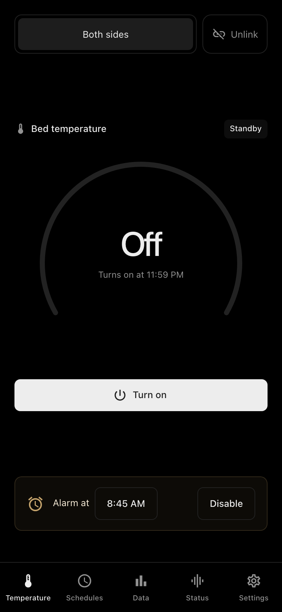
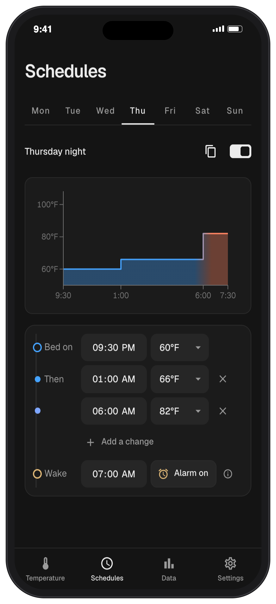
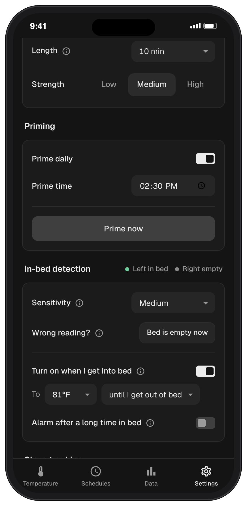

# Using Free Sleep

A first-use guide for the app, once it is installed ([INSTALLATION.md](../INSTALLATION.md)).
It was written against a Pod 5, the only model this fork was tested on. Where a Pod 3 or 4
differs, it says so; [POD_MODELS.md](POD_MODELS.md) has the detail.

## 1. Open the app

On a phone or computer on the same Wi-Fi as the Pod, open `http://<pod-ip>:3000`, for example
`http://192.168.1.50:3000`. On a Pod 5, `http://eight-pod.local:3000` also works.

To keep it on your phone's home screen: in Safari, tap Share, then **Add to Home Screen**. In
Chrome on Android, open the three-dot menu, then **Add to Home screen**.

The app has five pages: **Temperature**, **Schedules**, **Data**, **Status** and **Settings**.
There is no login. Anyone on your home network can open it.

## 2. Set the time zone

Do this first. Go to **Settings > Device settings** and choose your **Time Zone**. The schedule
and alarms run in this time zone, and it starts as UTC.

## 3. The Temperature page



- **Side picker**, at the top: choose which side you are controlling.
- **Link**, beside it: makes both sides act as one. While linked, the picker shows **Both sides**
  and the button reads **Unlink**. Linking copies this side's state to the other side at once.
- **The dial**: drag it to set the target temperature.
- **- and +**: one step colder or warmer. The app waits a moment after your last tap, then sends one change.
- **Turn on / Turn off**: the power button under the dial.
- **Bed at**: the water temperature the Pod measures, shown under the target. A Pod that does not
  report it shows "Currently at", the firmware's own estimate.
- **Turns off at / Turns on at**: the next scheduled power change, when tonight's schedule is on.

A side you turn on by hand turns itself off after 12 hours unless you change that (section 10).

## 4. Set one night

Each side has one schedule per night of the week. A night is named after the day it starts on:
"Monday night" runs from Monday evening into Tuesday morning.



1. Open **Schedules** and pick the side, or link the sides to set both at once.
2. Tap a day tab. Monday is first. The page opens on tonight.
3. On the **"Monday night"** row, check the switch on the right is on. Off means nothing runs that
   night: no power on or off, no temperature changes, no alarm.
4. On the **Bed on** row, set the time the bed turns on and the temperature it starts at.
5. To change the temperature during the night, tap **Add a change**, then set its time and
   temperature. Add as many as you like. The X at the end of a row removes it.
6. On the **Wake up** row, set the wake-up time.
7. Turn on the switch at the end of the Wake up row if you want the bed to vibrate at that time.
   With it off, the wake-up time still decides when the bed turns off.
8. Tap **Save for Mon** in the bar that appears at the bottom.

**There is no bed-off setting.** The bed turns off 30 minutes after the wake-up time.

The bar appears as soon as you edit anything:

| Button | What it does |
|---|---|
| **Discard** | Throws away your edits |
| **Other days…** | Opens "Save for which days?". Tick the days, then **Save**. This night replaces the one saved for each day you tick |
| **Save for Mon** | Saves to the open day only (the label names that day) |

Other day tabs are locked until you save or discard.

**Copying a saved night.** Tap the copy icon on the "Monday night" row, tick the days, then
**Save**. The icon is greyed out while there are unsaved edits.

## 5. Alarm options and testing

With the alarm switch on, an options button appears on the Wake up row, left of the switch. It
opens **Alarm options**:


| Option | Choices |
|---|---|
| **Vibration** | **Ramp up** builds to full strength over 40 seconds (Pod 5; a Pod 3 or 4 uses the firmware's own pattern). **Pulses** starts at full strength |
| **Strength** | 1 to 100% |
| **Length** | 10, 15, 20 or 30 minutes. It stops sooner if you dismiss it |
| **Warm-up** | Off, or 15, 30 or 45 minutes before the alarm, with a **Warm up to** temperature |
| **Bed off on dismiss** | The bed turns off the moment you dismiss the alarm, not 30 minutes after the wake-up time |

**Test for a minute** vibrates the bed now with the settings on screen, saved or not, even if the
bed is off. **Stop test** ends it. Tap **Done**, then save the night; options are saved with it.

A scheduled alarm only vibrates if that side is on at the alarm time.

## 6. Dismiss an alarm

- **Pod 5:** press any button on the side of the bed.
- **Pod 4:** tap the bed four times. Not tested in this fork.
- **Any Pod:** open the app. The Temperature page shows a **Dismiss Alarm** button while the bed vibrates.

The firmware stops both sides at once. If the sides are not linked, Free Sleep restarts the
other side's alarm from the beginning.

## 7. A one-time alarm

To wake at a different time once, without touching the weekly schedule:

1. On the **Temperature** page, find the "Alarm at" row. It only shows when tonight's schedule and its alarm are on.
2. Tap the time. **Change the next alarm** opens.
3. Pick the time and tap **Set**.

It goes off the next time the clock shows that time and replaces that morning's scheduled alarm.
The bed turns off 30 minutes after it. To undo it, open the same dialog and tap **Back to schedule**.
**Disable** on the same row skips tonight's alarm.

## 8. Display units

**Settings > Device settings > Temperature format**: Fahrenheit, Celsius, or Level. Level is -10 to
+10, the scale Eight Sleep's own app uses. The dial and the schedule follow your choice.

## 9. Pod 5 buttons

| Button | Bed on | Bed off |
|---|---|---|
| **-** or **+** | One step cooler or warmer per press | Turns that side on |
| **Middle**, held two seconds | Turns that side off | Turns that side on |
| Any button, while an alarm vibrates | Dismisses the alarm | |

When the sides are linked, the buttons on either side control both. The step size is in
**Settings > Side buttons**. A Pod 4 has tap gestures in place of buttons (**Settings > Tap gestures**).

## 10. Settings worth knowing



| Setting | Where | What it does |
|---|---|---|
| **When turned on by hand, stay on for** | Device settings | 3, 6 or 12 hours. Applies when you turn the bed on from the app, a shortcut or the buttons |
| **Ignore the schedule until it turns off** | Device settings | While a side you turned on yourself is on, its schedule is skipped. Alarms still go off |
| **Away mode** | Side settings, per side | For one person being away. That side's schedule and alarm stop, and it follows the other side |
| **Flip left and right** | Side settings | Swaps which physical side the app calls left and right. Each side keeps its name, schedule and settings |
| **Prime daily** | Priming | Runs the water priming cycle every day at **Prime time**, 2 PM by default. It does not check whether the bed is in use |
| **Reboot once a day** | Device | Restarts the Pod one hour before the priming time. A vibrating alarm or running warm-up is lost in a reboot, so keep the time in the afternoon |
| **In-bed detection** | Its own section, Pod 5 only | Two options, both off by default: **Turn on when I get into bed** and **Alarm after a long time in bed**. Detection was checked with one person on one Pod; the first option has been seen turning the bed on, the rest has not been seen working yet |

## 11. Updating

Either way takes about four minutes. The bed holds its temperature, but nothing scheduled runs
during the update.

- Over SSH (`ssh root@<pod-ip> -p 8822`), run:
  ```
  fs-update
  ```
- Or, when the app knows of a newer version, tap **Update free sleep** in **Settings > Device**.
  The button only shows then; `fs-update` works at any time.

**An update always ends with the internet block switched on**, even if you had turned it off.
To turn it off again, see [INSTALLATION.md](../INSTALLATION.md#16-block-the-internet).

More detail on everything here: [HOW_IT_WORKS.md](HOW_IT_WORKS.md). Phone shortcuts:
[IOS_SHORTCUTS.md](IOS_SHORTCUTS.md). Access from outside your home: [REMOTE_ACCESS.md](REMOTE_ACCESS.md).
