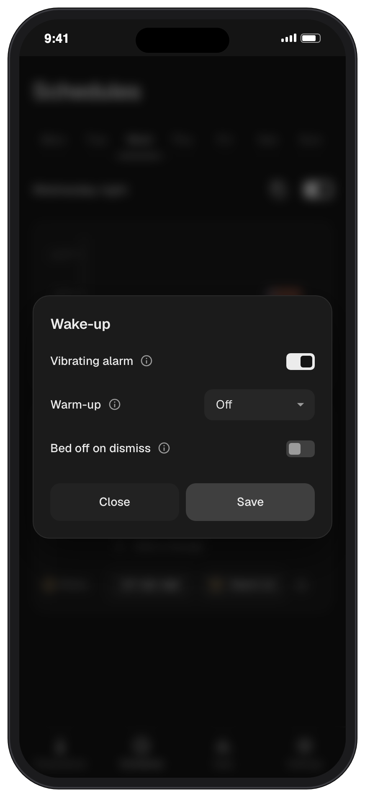

# Using SevenSleep

A first-use guide for the app, once it is installed ([INSTALLATION.md](../INSTALLATION.md)).
It was written against a Pod 5, the only model SevenSleep was tested on. Where a Pod 3 or 4
differs, it says so; [POD_MODELS.md](POD_MODELS.md) has the detail.

## 1. Open the app

On a phone or computer on the same Wi-Fi as the Pod, open `http://<pod-ip>:3000`, for example
`http://192.168.1.50:3000`. `http://sevensleep.local` also works where the installer could set the name up.

To keep it on your phone's home screen: in Safari, tap Share, then **Add to Home Screen**. In
Chrome on Android, open the three-dot menu, then **Add to Home screen**.

The app has four tabs: **Temperature**, **Schedules**, **Data** and **Settings**. The **Status** page opens from the "Status: Healthy" link, at the bottom right on a computer and beside the heading of Data and Settings on a phone.
There is no login. Anyone on your home network can open it.

## 2. Set the time zone

Do this first. Go to **Settings > General** and choose your **Time zone** (shown like "PST (UTC−8)"). The schedule
and alarms run in this time zone, and it starts as UTC.

## 3. The Temperature page


- **Which side**: the page shows and changes the side picked under **Settings > General > This device controls**
  (Left, Right or Both). Left or right is remembered on the device, so two people can each keep their own side
  on their own phone. **Both** makes the two sides act as one for everyone, and copies this side's state to
  the other at once.
- **The dial**: drag it to set the target temperature.
- **- and +**: one step colder or warmer. The app waits a moment after your last tap, then sends one change.
- **Power**: the power button, in line with the heading on a phone and at the top right of the dial's section on a
  wider screen, turns the side off. While the side is off, tap anywhere in that section to turn it on.
- **Bed at**: the water temperature the Pod measures, shown under the target. A Pod that does not
  report it shows "Currently at", the firmware's own estimate.
- **The next alarm**, inside the dial while the bed is on: its time, with "Off at" and the time the bed turns
  off beside it. Tap it to change the next alarm or skip it (section 7). With no alarm tonight it reads
  "Turns off at"; while the bed is off, "Turns on at".

A side you turn on by hand turns itself off after 12 hours unless you change that (section 10).

## 4. Set one night

Each side has one schedule per night of the week. A night is named after the day it starts on:
"Monday night" runs from Monday evening into Tuesday morning.


1. Open **Schedules** and pick the side, or link the sides to set both at once.
2. Tap a day tab. Monday is first. The page opens on tonight.
3. On the **"Monday night"** row, check the switch on the right is on. Off means nothing runs that
   night: no power on or off, no temperature changes, no alarm.
4. On the **Bed on** row, set the time the bed turns on and the temperature it starts at.
5. To change the temperature during the night, tap **Add a change**, then set its time and
   temperature. Add as many as you like. The X at the end of a row removes it.
6. On the **Wake** row, set the wake-up time.
7. Tap **Alarm off** on the Wake row and turn the switch on if you want the bed to vibrate at that time.
   With it off, the wake-up time still decides when the bed turns off.
8. Tap **Save** in the bar that appears at the bottom.

**There is no bed-off setting.** The bed turns off 30 minutes after the wake-up time.

**Discard** and **Save** appear under the night as soon as you edit anything:

| Button | What it does |
|---|---|
| **Discard** | Throws away your edits |
| **Save** | Saves to the open day. To use the same night on other days, save, then use the copy button beside the night's name |

Other day tabs are locked until you save or discard.

**Copying a saved night.** Tap the copy icon on the "Monday night" row, tick the days, then
**Save**. The icon is greyed out while there are unsaved edits.

## 5. Wake-up options and the alarm

The **Alarm on** / **Alarm off** button on the Wake row opens that night's wake-up options:



| Option | Choices |
|---|---|
| **Vibrating alarm** | On or off for this night |
| **Warm-up** | Off, or 15, 30 or 45 minutes before the alarm, with a **Warm up to** temperature |
| **Bed off on dismiss** | The bed turns off the moment you dismiss the alarm, not 30 minutes after the wake-up time |

**Save** saves the night with these options; **Discard** puts them back as they were when you
opened the dialog.

How the alarm vibrates is one choice for every night and both sides, in **Settings > Alarm**:

| Setting | Choices |
|---|---|
| **Vibration** | **Ramp up** builds to full strength over 40 seconds (Pod 5; a Pod 3 or 4 uses the firmware's own pattern). **Pulses** starts at full strength |
| **Strength** | Low, Medium or High |
| **Length** | 10, 15, 20 or 30 minutes. It stops sooner if you dismiss it |

**Test for a minute**, at the top of that section, vibrates both sides now with those settings,
even if the bed is off. **Stop test** ends it.

A scheduled alarm only vibrates if that side is on at the alarm time.

## 6. Dismiss an alarm

- **Pod 5:** press any button on the side of the bed.
- **Pod 4:** tap the bed four times. Not tested in SevenSleep.
- **Any Pod:** open the app. The Temperature page shows a **Dismiss Alarm** button while the bed vibrates.

A press stops the alarm on the side it was made on, and that side gives a short double buzz to
say so. If both sides began going off together it is one alarm, and one press stops both. If
the other side's alarm began at a different time, it carries on (it starts over from the
beginning, because the firmware can only stop both sides at once).

## 7. A one-time alarm

To wake at a different time once, without touching the weekly schedule:

1. On the **Temperature** page, tap the alarm's time inside the dial. It shows while the bed is on and tonight's
   schedule and its alarm are on.
2. Choose **Change the next alarm**. **Change next alarm only (overrides schedule)** opens.
3. Pick the time and tap **Set**.

It goes off the next time the clock shows that time and replaces that morning's scheduled alarm.
The bed turns off 30 minutes after it. To undo it, set the time back to the schedule's own in the same dialog.
**Skip the next alarm**, in the same menu, skips tonight's alarm after you confirm. Once skipped, the dial reads
**Alarm off** and the menu offers to turn it back on.

## 8. Display units

**Settings > General > Temperature shown as**: Fahrenheit, Celsius, or Level. Level is -10 to
+10, the scale Eight Sleep's own app uses. The dial and the schedule follow your choice.

## 9. Pod 5 buttons

> **Pod 3:** no buttons or taps. **Pod 4:** taps instead, set up in **Settings > Tap gestures**;
> multi-tap handling changed from Free Sleep and has not been run on a Pod 4.

| Button | Bed on | Bed off |
|---|---|---|
| **-** or **+** | One step cooler or warmer per press | Turns that side on |
| **Middle**, held a second and a half | Turns that side off | Turns that side on |
| Any button, while an alarm vibrates | Dismisses the alarm | |

When the sides are linked, the buttons on either side control both. The step size is in
**Settings > General**. A Pod 4 has tap gestures in place of buttons (**Settings > Tap gestures**).

## 10. Settings worth knowing


| Setting | Where | What it does |
|---|---|---|
| **Manual on lasts** | General | 3, 6 or 12 hours. Applies when you turn the bed on from the app, a shortcut or the buttons |
| **This device controls** | General | Left, Right or Both: the side the Temperature and Schedules pages show and change. Left or right is remembered on the device; Both links the sides for everyone |
| **Pause the schedule until it turns off** | General | When you turn the bed on yourself, the schedule leaves it alone until it turns off: no temperature changes, warm-up or scheduled off time. Alarms still go off |
| **Away mode** | General | For when nobody is home. The schedule and alarms stop on both sides until you switch it off |
| **Flip left and right** | General | Swaps which physical side the app calls left and right. Each side keeps its schedule and settings |
| **Light on the hub** | General | The hub's light, on or off |
| **Prime daily** | Priming | Runs the water priming cycle every day at **Prime time**, 2 PM by default. It does not check whether the bed is in use |
| **Reboot once a day** | Pod | Restarts the Pod one hour before the priming time. A vibrating alarm or running warm-up is lost in a reboot, so keep the time in the afternoon |
| **Status page** | The "Status" link (bottom right on a computer, beside the heading of Data and Settings on a phone) | Shows Wi-Fi strength, whether SevenSleep is up to date, and each service. The biometrics and sleep-analysis rows are greyed and marked untested |
| **API** | Settings > API > **Open** | A page with the common requests and two examples with your Pod's address filled in. Tap a command to select it. The page's own address is `/api-guide` |
| **In-bed detection** | Its own section, Pod 5 only | Two options, both off by default: **Turn on when I get into bed** and **Alarm after a long time in bed**. Detection was checked with one person on one Pod; the first option has been seen turning the bed on, the rest has not been seen working yet |
| **Autopilot** | Its own section, Pod 5 only | **Adjust the temperature while I sleep**, off by default. Moves a sleeping side up to 4°F around its set temperature: cooler early, warmer toward morning, against a room that warms or cools, and it learns from the changes you make. It treats the bed as one sleeper's, so switching it on links the sides. A temperature you set in the night is held as you set it. A nap (a sleep under 3 hours) is left alone. **Data > Sleep** shows a day at a time (bedtime, wake time, duration, wake-ups, and graphs of breathing rate, pressure and temperature changes), and **Export** downloads a week to three months. Sleep tracker sync is iPhone only. **Sleep tracker > Link** has the steps for an iPhone Shortcut that sends a watch's or band's sleep each morning, which the bed uses to tune how it judges sleep. Experimental and not yet run through a night; see [AUTOPILOT.md](AUTOPILOT.md) |

## 11. Updating

Either way takes about four minutes. The bed holds its temperature, but nothing scheduled runs
during the update.

- Over SSH (`ssh root@<pod-ip> -p 8822`), run:
  ```
  fs-update
  ```
- Or, when the app knows of a newer version, tap **Update** next to the SevenSleep version in **Settings > Pod**.
  The button only shows then; `fs-update` works at any time.

**An update always ends with the internet block switched on**, even if you had turned it off.
To turn it off again, see [INSTALLATION.md](../INSTALLATION.md#16-block-the-internet).

More detail on everything here: [HOW_IT_WORKS.md](HOW_IT_WORKS.md). Phone shortcuts:
[IOS_SHORTCUTS.md](IOS_SHORTCUTS.md). Access from outside your home: [REMOTE_ACCESS.md](REMOTE_ACCESS.md).
